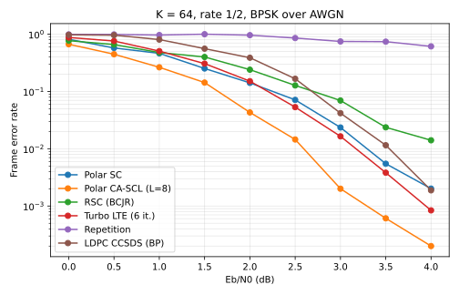

# pyAFF3CT

**Forward error correction at C++ speed, from Python.**

📖 [Documentation](https://rtajan.pages.bordeaux-inp.fr/pyaff3ct/): tutorial, how-to guides, API reference

pyAFF3CT is the Python interface of [AFF3CT](https://aff3ct.github.io), *A Fast Forward Error Correction Toolbox*:
the encoders, decoders, modems and channels of one of the fastest FEC libraries (SIMD, fixed point, multi-threaded),
driven by a few lines of Python. Built on [pyStreamPU](https://github.com/aff3ct/pystreampu), a chain written as plain
Python calls is also a task graph that runs in C++, on as many threads as you want.

<p align="center">
  
</p>

## Highlights

- **Every major code family**: polar (SC, SCL, CA-SCL, SCAN, BP, multi-kernel), LDPC (BP flooding and layered,
  sum-product and min-sum variants, bit flipping, any AList matrix: CCSDS, Wi-MAX, MacKay...), turbo (LTE, CCSDS,
  double-binary DVB-RCS), turbo product, BCH, Reed-Solomon, convolutional (BCJR), repeat-accumulate, repetition.
- **Modems and channels**: BPSK, PAM, PSK, QAM, CPM, any constellation given as a list of symbols; AWGN, Rayleigh,
  erasure and binary symmetric channels.
- **Fast**: decoders in floating point or 8 / 16-bit fixed point, SIMD implementations, multi-threaded
  simulations (`streampu.Sequence(..., n_threads=n)`) with a C++ execution of the whole chain.
- **Pythonic**: one function per module (`af.dec.polar(...)`), sockets as NumPy arrays, codecs that build and connect
  all the modules of a code (`af.codec.turbo(...)`), type stubs for the autocompletion of the IDEs.
- **Same parameters as the AFF3CT simulator**: keyword arguments named after the command-line options
  (`--dec-type` → `dec_type`), or the command line itself (`Factory.from_cli("...")`).
- **Validated**: the test suite rebuilds the chains of 33 AFF3CT reference curves from their command lines and
  checks the simulated error rates against them; every example of the documentation is run by the CI.

## In a nutshell

A polar code with CRC-aided list decoding, simulated on 4 threads until 100 frame errors at each Eb/N0:

```python
import streampu as spu
import aff3ct as af

K, N = 64, 128
crc = af.crc.crc(K - 8, type="8-DVB-S2")                       # CRC-aided list decoding of a polar code
cdc = af.codec.polar(K, N, crc, dec_type="SCL", dec_L=8)       # same parameters as the AFF3CT command line
src = af.src.source(K - 8, type="RAND")
mdm, chn = af.mdm.modem(N, type="BPSK"), af.chn.channel(N, type="AWGN")
mnt = af.mnt.Monitor_BFER_AR(K - 8, 100)                       # stops after 100 frame errors

sigma = spu.array([1.0], dtype=spu.float32)
u = src.generate()[0]                                          # each call runs an AFF3CT task... and binds it
x = cdc.encoder.encode(crc.build(u))
_, v = cdc.decoder_siho.decode_siho(mdm.demodulate(sigma, chn.add_noise(sigma, mdm.modulate(x))))
mnt.check_errors(u, crc.extract(v))

for ebn0 in [1.0, 2.0, 3.0]:
    noise = af.tools.sigma_from_ebn0(ebn0, (K - 8) / N)
    sigma.numpy[...] = noise.sigma
    cdc.set_noise(noise)                                       # frozen bits for this noise
    mnt.reset()
    seq = spu.Sequence(mnt["check_errors::status"], n_threads=4)   # the whole chain in C++, on 4 threads
    af.tools.seed_sequence(seq)                                    # each thread its own frames and noise
    seq.exec()
    print(f"Eb/N0 = {ebn0} dB  FER = {mnt.fer:.2e}  BER = {mnt.ber:.2e}")
```

```
Eb/N0 = 1.0 dB  FER = 2.62e-01  BER = 4.57e-02
Eb/N0 = 2.0 dB  FER = 3.83e-02  BER = 4.74e-03
Eb/N0 = 3.0 dB  FER = 2.05e-03  BER = 3.02e-04
```

Or configure a code with an AFF3CT command line, here the LTE turbo code punctured to rate 1/2:

```python
cli = ('-K 2048 -N 4108 --enc-sub-std LTE -i 8 --dec-sf-type LTE_VEC --dec-sub-implem FAST '
       '--pct-pattern "11,10,01"')
fac = af.factory.Codec_turbo()
fac.enable_puncturer()                 # as the AFF3CT simulator: -N is the frame size after puncturing
fac.from_cli(cli, strict=False)        # strict=False: the options of the other factories are ignored
cdc = fac.build()                      # cdc.encoder, cdc.puncturer, cdc.decoder_siho...
```

## Installation

pyAFF3CT is compiled against pyStreamPU (same StreamPU library, same pybind11): install pyStreamPU first, then build
pyAFF3CT without build isolation in the same environment.

```bash
pip install "git+https://github.com/rtajan/pystreampu.git@v1.2.1"
pip install scikit-build-core setuptools_scm pybind11==3.0.4 pybind11-stubgen==2.5.5

git clone --recursive <this repository> && cd pyaff3ct
pip install -v . --no-build-isolation
```

Requirements: Python ≥ 3.10, a C++17 compiler, CMake ≥ 3.18. The first build compiles AFF3CT for every precision
(about 15 minutes on 2 cores); `ARCH_FLAGS=-march=native` tunes it for the host. Start Python outside the root of the
repository: there, `import aff3ct` would import the sources instead of the installed package.

## Documentation

The [documentation](https://rtajan.pages.bordeaux-inp.fr/pyaff3ct/) (MkDocs, published by the CI on GitLab Pages,
and by `.github/workflows/docs.yml` on GitHub Pages) has a tutorial, how-to guides for
polar, LDPC and turbo codes, modulations and fixed point, the concepts, and the API reference. Its figures are
computed by its examples at each build. Locally:

```bash
pip install ".[docs]" --no-build-isolation
python scripts/doc_figures.py && mkdocs serve
```

The scripts of [`examples/`](examples) are complete simulations: first chain, polar / LDPC / turbo BER-FER curves,
code comparison, modulations, fixed point, command-line parity.

## Development

```bash
pip install pytest pytest-xdist scipy matplotlib
scripts/fetch_aff3ct_data.sh                       # AFF3CT reference curves and LDPC matrices of the tests
pytest tests -n 4                                  # not `python -m pytest` from the root

PYTHON=path/to/python scripts/dev_build.sh         # incremental development build (build/dev, linked in aff3ct/)
```

- [`Plan.md`](Plan.md): architecture, wrapping rules and roadmap (phases 0 to 3 done: every code family, generic
  modems, fixed point; next: advanced modules, wheels);
- [`docs/design/`](docs/design): class graph of AFF3CT and per-class wrapping status, regenerated after an AFF3CT
  bump with `python3 scripts/gen_class_graph.py path/to/aff3ct/include docs/design`;
- the factories and module functions are generated from the AFF3CT headers (`scripts/gen_factories.py`).

## License

MIT, as AFF3CT. AFF3CT is developed by the [AFF3CT team](https://aff3ct.github.io); if you use it in a publication,
please cite its [SoftwareX paper](https://doi.org/10.1016/j.softx.2019.100345).
