# Graphe des classes à wrapper

> Fichier généré par `scripts/gen_class_graph.py` à partir des en-têtes AFF3CT — ne pas éditer à la main.

Légende : gris = déjà wrappé par **pystreampu** (importé, jamais re-wrappé) · bleu = classe de base/interface (liée sans constructeur, sert au polymorphisme et au downcast) · vert = liée avec constructeur(s) · orange = atteignable **uniquement via une factory** (paramètres template de politique : `API_polar`, `Update_rule`, `MAX`, pointeurs de fonction…) · violet = fonctions libres/statiques · pointillés = non exposé.

Flèche pleine = héritage C++ (à reproduire dans `py::class_<T, Bases...>`). Flèche pointillée `uses` = type demandé par un constructeur ou un `build()` : il **doit** être wrappé.

## 1. Vue d'ensemble

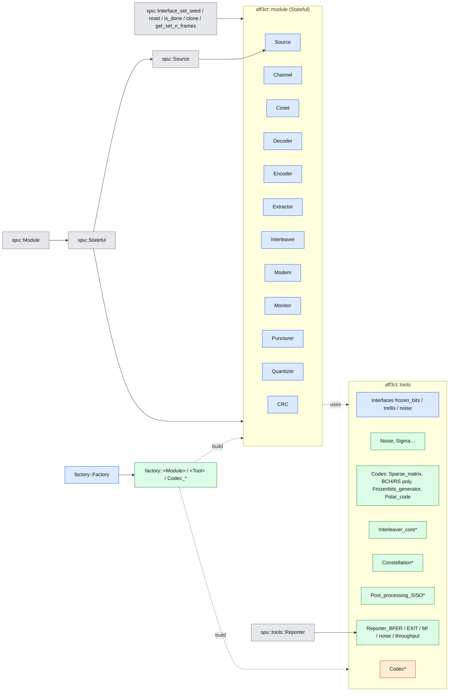

## 2. Modules (`aff3ct::module`)

### CRC

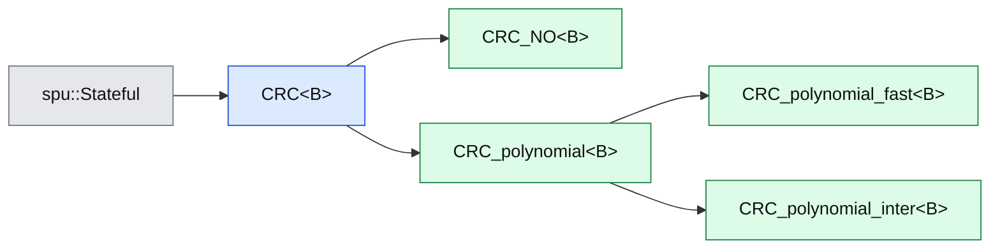

### Channel

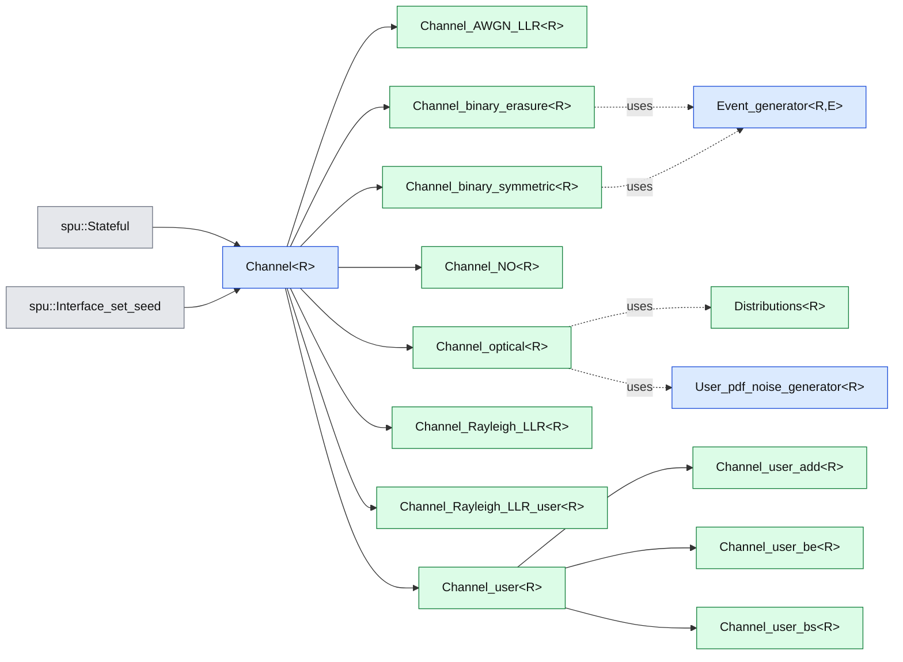

### Coset

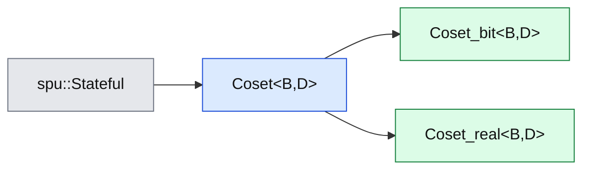

### Decoder — hiérarchie de base (HIHO → SIHO → SISO)

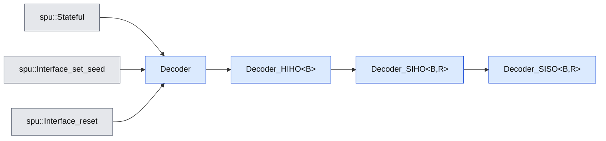

### Decoder — BCH

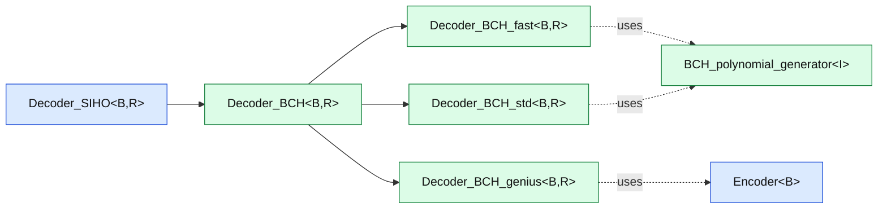

### Decoder — Conv

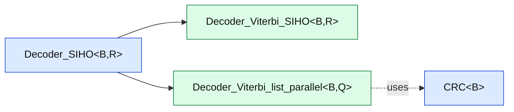

### Decoder — Generic

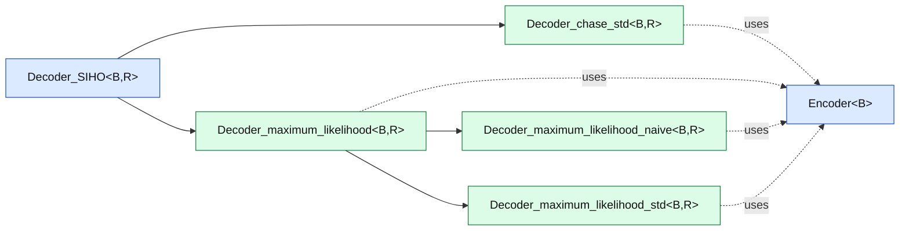

### Decoder — LDPC

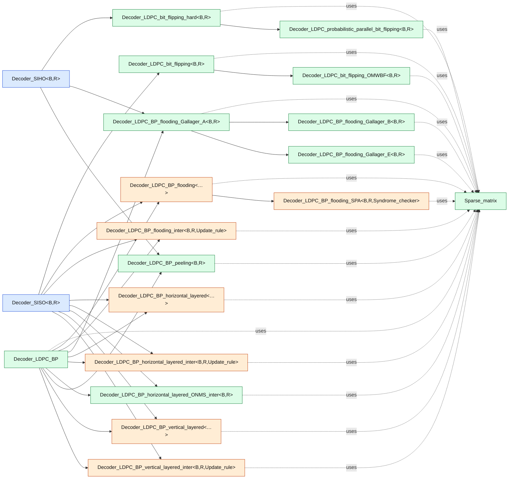

### Decoder — NO

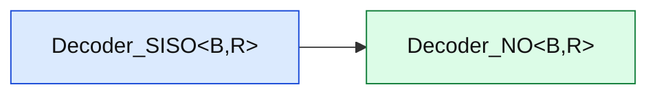

### Decoder — Polar

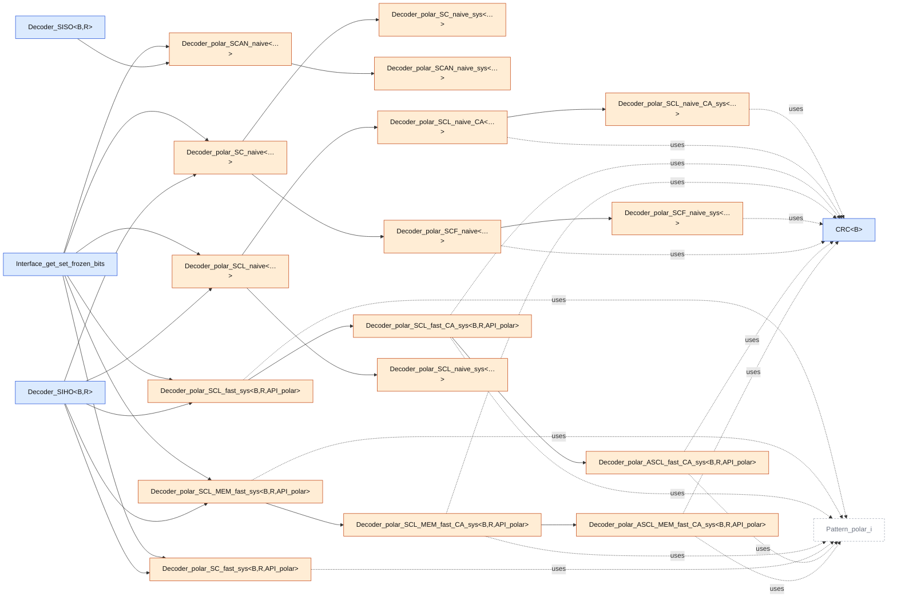

### Decoder — Polar_MK

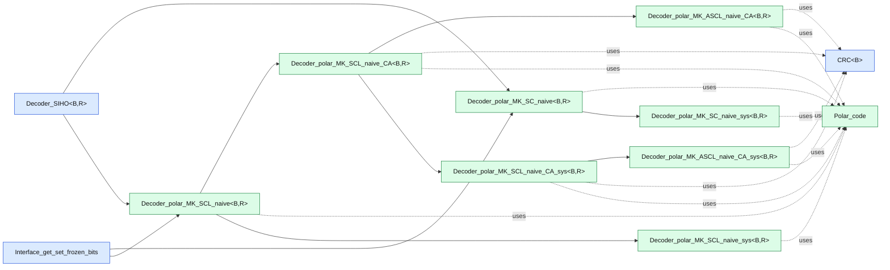

### Decoder — Polar_PAC

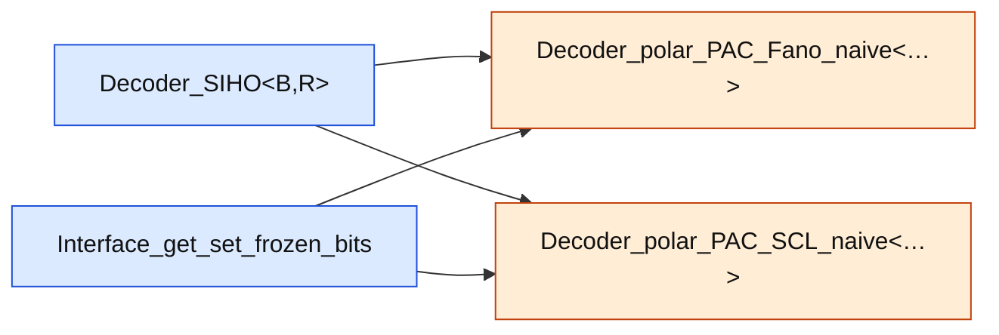

### Decoder — Polar_PT

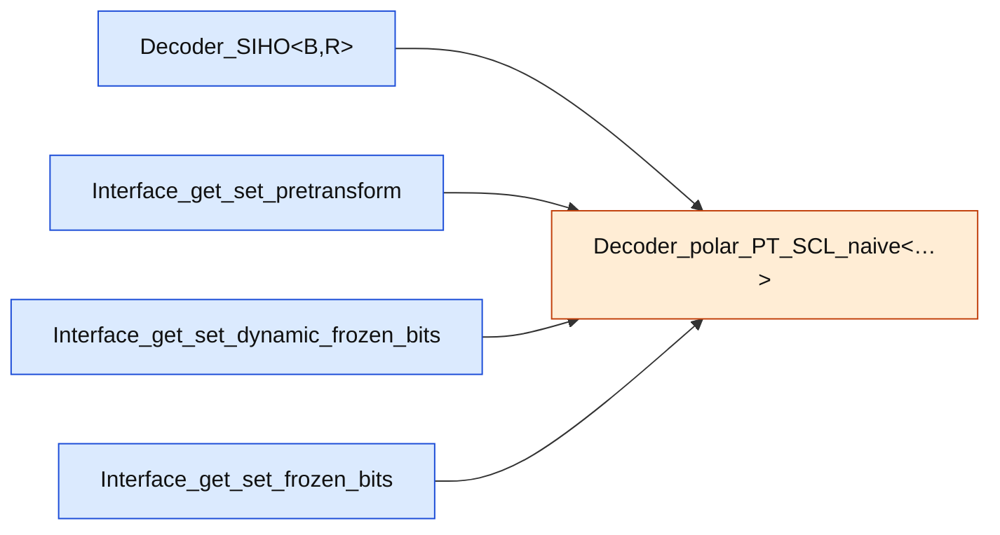

### Decoder — RA


### Decoder — RS

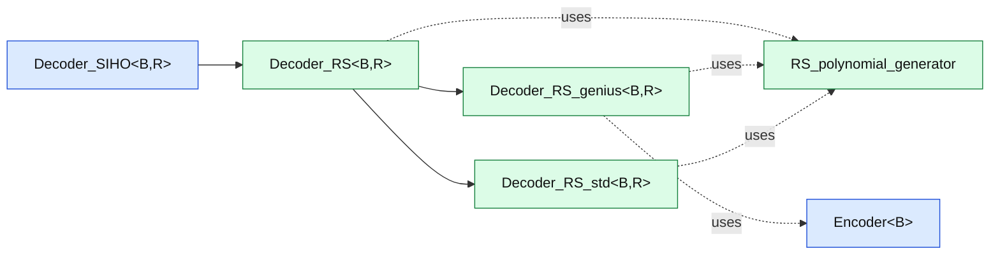

### Decoder — RSC

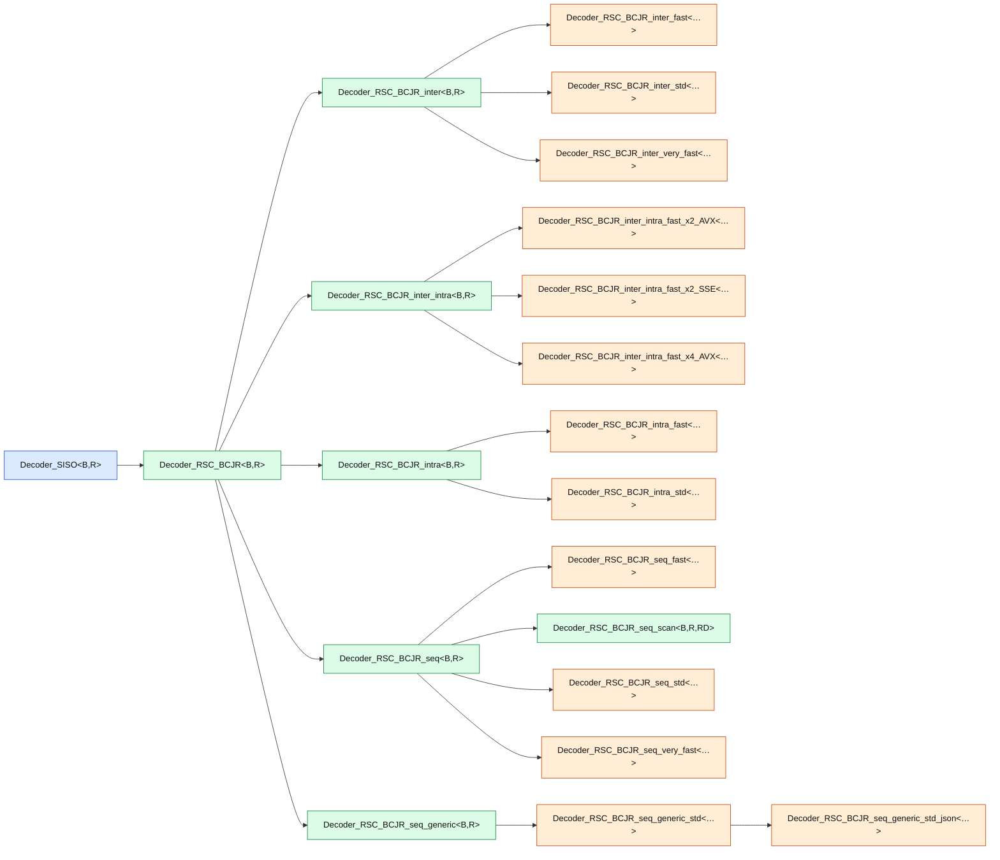

### Decoder — RSC_DB

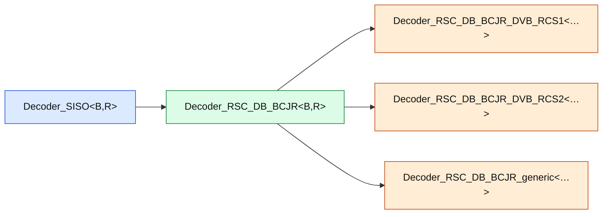

### Decoder — Repetition

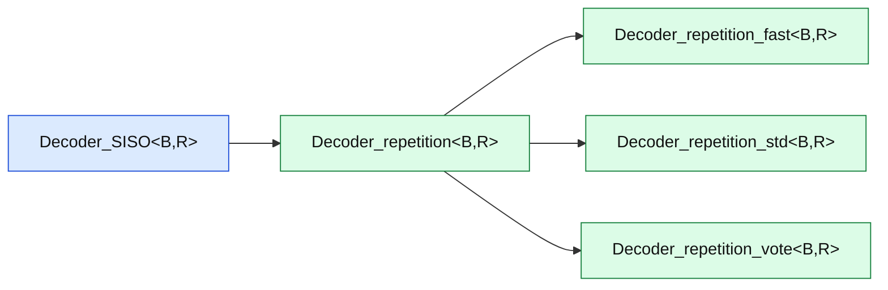

### Decoder — Turbo

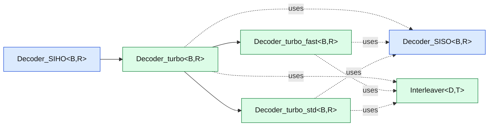

### Decoder — Turbo_DB

```mermaid
graph LR
    classDef spu fill:#e5e7eb,stroke:#6b7280,color:#111;
    classDef abstract fill:#dbeafe,stroke:#1d4ed8,color:#111;
    classDef wrap fill:#dcfce7,stroke:#15803d,color:#111;
    classDef factory fill:#ffedd5,stroke:#c2410c,color:#111;
    classDef func fill:#f3e8ff,stroke:#7e22ce,color:#111;
    classDef skip fill:#fff,stroke:#9ca3af,color:#6b7280,stroke-dasharray: 4 3;
    M_Decoder_turbo_DB["Decoder_turbo_DB&lt;B,R&gt;"]:::wrap
    M_Decoder_SIHO --> M_Decoder_turbo_DB
    M_Decoder_turbo_DB -.uses.-> M_Decoder_RSC_DB_BCJR
    M_Decoder_turbo_DB -.uses.-> M_Interleaver
    M_Decoder_RSC_DB_BCJR["Decoder_RSC_DB_BCJR&lt;B,R&gt;"]:::wrap
    M_Decoder_SIHO["Decoder_SIHO&lt;B,R&gt;"]:::abstract
    M_Interleaver["Interleaver&lt;D,T&gt;"]:::wrap
```

### Decoder — Turbo_product

```mermaid
graph LR
    classDef spu fill:#e5e7eb,stroke:#6b7280,color:#111;
    classDef abstract fill:#dbeafe,stroke:#1d4ed8,color:#111;
    classDef wrap fill:#dcfce7,stroke:#15803d,color:#111;
    classDef factory fill:#ffedd5,stroke:#c2410c,color:#111;
    classDef func fill:#f3e8ff,stroke:#7e22ce,color:#111;
    classDef skip fill:#fff,stroke:#9ca3af,color:#6b7280,stroke-dasharray: 4 3;
    M_Decoder_chase_pyndiah["Decoder_chase_pyndiah&lt;B,R&gt;"]:::wrap
    M_Decoder_chase_pyndiah_fast["Decoder_chase_pyndiah_fast&lt;B,R&gt;"]:::wrap
    M_Decoder_turbo_product["Decoder_turbo_product&lt;B,R&gt;"]:::wrap
    M_Decoder_SISO --> M_Decoder_chase_pyndiah
    M_Decoder_chase_pyndiah --> M_Decoder_chase_pyndiah_fast
    M_Decoder_SISO --> M_Decoder_turbo_product
    M_Decoder_SISO["Decoder_SISO&lt;B,R&gt;"]:::abstract
```

### Encoder

```mermaid
graph LR
    classDef spu fill:#e5e7eb,stroke:#6b7280,color:#111;
    classDef abstract fill:#dbeafe,stroke:#1d4ed8,color:#111;
    classDef wrap fill:#dcfce7,stroke:#15803d,color:#111;
    classDef factory fill:#ffedd5,stroke:#c2410c,color:#111;
    classDef func fill:#f3e8ff,stroke:#7e22ce,color:#111;
    classDef skip fill:#fff,stroke:#9ca3af,color:#6b7280,stroke-dasharray: 4 3;
    M_Encoder_AZCW["Encoder_AZCW&lt;B&gt;"]:::wrap
    M_Encoder_BCH["Encoder_BCH&lt;B&gt;"]:::wrap
    M_Encoder_BCH_inter["Encoder_BCH_inter&lt;B&gt;"]:::wrap
    M_Encoder_conv["Encoder_conv&lt;B&gt;"]:::wrap
    M_Encoder_coset["Encoder_coset&lt;B&gt;"]:::wrap
    M_Encoder["Encoder&lt;B&gt;"]:::abstract
    M_Encoder_LDPC_DVBS2["Encoder_LDPC_DVBS2&lt;B&gt;"]:::wrap
    M_Encoder_LDPC["Encoder_LDPC&lt;B&gt;"]:::wrap
    M_Encoder_LDPC_from_H["Encoder_LDPC_from_H&lt;B&gt;"]:::wrap
    M_Encoder_LDPC_from_IRA["Encoder_LDPC_from_IRA&lt;B&gt;"]:::wrap
    M_Encoder_LDPC_from_QC["Encoder_LDPC_from_QC&lt;B&gt;"]:::wrap
    M_Encoder_LDPC_QC["Encoder_LDPC_QC&lt;B&gt;"]:::wrap
    M_Encoder_LDPC_QC_fast["Encoder_LDPC_QC_fast&lt;B&gt;"]:::wrap
    M_Encoder_NO["Encoder_NO&lt;B&gt;"]:::wrap
    M_Encoder_polar["Encoder_polar&lt;B&gt;"]:::wrap
    M_Encoder_polar_bitpacked["Encoder_polar_bitpacked&lt;B&gt;"]:::wrap
    M_Encoder_polar_bitpacked_sys["Encoder_polar_bitpacked_sys&lt;B&gt;"]:::wrap
    M_Encoder_polar_sys["Encoder_polar_sys&lt;B&gt;"]:::wrap
    M_Encoder_polar_MK["Encoder_polar_MK&lt;B&gt;"]:::wrap
    M_Encoder_polar_MK_sys["Encoder_polar_MK_sys&lt;B&gt;"]:::wrap
    M_Encoder_polar_PAC["Encoder_polar_PAC&lt;B&gt;"]:::wrap
    M_Encoder_polar_PT["Encoder_polar_PT&lt;B&gt;"]:::wrap
    M_Encoder_RA["Encoder_RA&lt;B&gt;"]:::wrap
    M_Encoder_RS["Encoder_RS&lt;B&gt;"]:::wrap
    M_Encoder_RSC3_CPE_sys["Encoder_RSC3_CPE_sys&lt;B&gt;"]:::wrap
    M_Encoder_RSC_generic_json_sys["Encoder_RSC_generic_json_sys&lt;B&gt;"]:::wrap
    M_Encoder_RSC_generic_sys["Encoder_RSC_generic_sys&lt;B&gt;"]:::wrap
    M_Encoder_RSC_sys["Encoder_RSC_sys&lt;B&gt;"]:::wrap
    M_Encoder_RSC_DB["Encoder_RSC_DB&lt;B&gt;"]:::wrap
    M_Encoder_repetition_sys["Encoder_repetition_sys&lt;B&gt;"]:::wrap
    M_Encoder_turbo["Encoder_turbo&lt;B&gt;"]:::wrap
    M_Encoder_turbo_legacy["Encoder_turbo_legacy&lt;B&gt;"]:::wrap
    M_Encoder_turbo_DB["Encoder_turbo_DB&lt;B&gt;"]:::wrap
    M_Encoder_turbo_product["Encoder_turbo_product&lt;B&gt;"]:::wrap
    M_Encoder_user["Encoder_user&lt;B&gt;"]:::wrap
    M_Encoder --> M_Encoder_AZCW
    M_Encoder --> M_Encoder_BCH
    M_Encoder_BCH -.uses.-> T_BCH_polynomial_generator
    M_Encoder_BCH --> M_Encoder_BCH_inter
    M_Encoder_BCH_inter -.uses.-> T_BCH_polynomial_generator
    M_Encoder --> M_Encoder_conv
    T_Interface_get_trellis --> M_Encoder_conv
    M_Encoder --> M_Encoder_coset
    S_Stateful --> M_Encoder
    S_Interface_set_seed --> M_Encoder
    M_Encoder_LDPC --> M_Encoder_LDPC_DVBS2
    M_Encoder --> M_Encoder_LDPC
    M_Encoder_LDPC -.uses.-> T_Sparse_matrix
    M_Encoder_LDPC --> M_Encoder_LDPC_from_H
    M_Encoder_LDPC_from_H -.uses.-> T_Sparse_matrix
    M_Encoder_LDPC --> M_Encoder_LDPC_from_IRA
    M_Encoder_LDPC_from_IRA -.uses.-> T_Sparse_matrix
    M_Encoder_LDPC --> M_Encoder_LDPC_from_QC
    M_Encoder_LDPC_from_QC -.uses.-> T_Sparse_matrix
    M_Encoder_LDPC --> M_Encoder_LDPC_QC
    M_Encoder_LDPC_QC --> M_Encoder_LDPC_QC_fast
    M_Encoder --> M_Encoder_NO
    M_Encoder --> M_Encoder_polar
    T_Interface_get_set_frozen_bits --> M_Encoder_polar
    M_Encoder_polar --> M_Encoder_polar_bitpacked
    M_Encoder_polar_bitpacked --> M_Encoder_polar_bitpacked_sys
    M_Encoder_polar --> M_Encoder_polar_sys
    M_Encoder --> M_Encoder_polar_MK
    T_Interface_get_set_frozen_bits --> M_Encoder_polar_MK
    M_Encoder_polar_MK -.uses.-> T_Polar_code
    M_Encoder_polar_MK --> M_Encoder_polar_MK_sys
    M_Encoder_polar_MK_sys -.uses.-> T_Polar_code
    M_Encoder_polar --> M_Encoder_polar_PAC
    M_Encoder_polar --> M_Encoder_polar_PT
    T_Interface_get_set_pretransform --> M_Encoder_polar_PT
    T_Interface_get_set_dynamic_frozen_bits --> M_Encoder_polar_PT
    M_Encoder --> M_Encoder_RA
    M_Encoder_RA -.uses.-> M_Interleaver
    M_Encoder --> M_Encoder_RS
    M_Encoder_RS -.uses.-> T_RS_polynomial_generator
    M_Encoder_RSC_sys --> M_Encoder_RSC3_CPE_sys
    M_Encoder_RSC_generic_sys --> M_Encoder_RSC_generic_json_sys
    M_Encoder_RSC_sys --> M_Encoder_RSC_generic_sys
    M_Encoder --> M_Encoder_RSC_sys
    T_Interface_get_trellis --> M_Encoder_RSC_sys
    M_Encoder --> M_Encoder_RSC_DB
    T_Interface_get_trellis --> M_Encoder_RSC_DB
    M_Encoder --> M_Encoder_repetition_sys
    M_Encoder --> M_Encoder_turbo
    M_Encoder_turbo -.uses.-> M_Interleaver
    M_Encoder_turbo --> M_Encoder_turbo_legacy
    M_Encoder_turbo_legacy -.uses.-> M_Interleaver
    M_Encoder --> M_Encoder_turbo_DB
    M_Encoder_turbo_DB -.uses.-> M_Interleaver
    M_Encoder --> M_Encoder_turbo_product
    M_Encoder_turbo_product -.uses.-> M_Interleaver
    M_Encoder --> M_Encoder_user
    M_Interleaver["Interleaver&lt;D,T&gt;"]:::wrap
    S_Interface_set_seed["spu::Interface_set_seed"]:::spu
    S_Stateful["spu::Stateful"]:::spu
    T_BCH_polynomial_generator["BCH_polynomial_generator&lt;I&gt;"]:::wrap
    T_Interface_get_set_dynamic_frozen_bits["Interface_get_set_dynamic_frozen_bits"]:::abstract
    T_Interface_get_set_frozen_bits["Interface_get_set_frozen_bits"]:::abstract
    T_Interface_get_set_pretransform["Interface_get_set_pretransform"]:::abstract
    T_Interface_get_trellis["Interface_get_trellis"]:::abstract
    T_Polar_code["Polar_code"]:::wrap
    T_RS_polynomial_generator["RS_polynomial_generator"]:::wrap
    T_Sparse_matrix["Sparse_matrix"]:::wrap
```

### Extractor

```mermaid
graph LR
    classDef spu fill:#e5e7eb,stroke:#6b7280,color:#111;
    classDef abstract fill:#dbeafe,stroke:#1d4ed8,color:#111;
    classDef wrap fill:#dcfce7,stroke:#15803d,color:#111;
    classDef factory fill:#ffedd5,stroke:#c2410c,color:#111;
    classDef func fill:#f3e8ff,stroke:#7e22ce,color:#111;
    classDef skip fill:#fff,stroke:#9ca3af,color:#6b7280,stroke-dasharray: 4 3;
    M_Extractor["Extractor&lt;B,Q&gt;"]:::abstract
    M_Extractor_LDPC["Extractor_LDPC&lt;B,Q&gt;"]:::wrap
    M_Extractor_polar["Extractor_polar&lt;B,Q&gt;"]:::wrap
    M_Extractor_RSC["Extractor_RSC&lt;B,Q&gt;"]:::wrap
    M_Extractor_uncoded["Extractor_uncoded&lt;B,Q&gt;"]:::wrap
    S_Stateful --> M_Extractor
    M_Extractor --> M_Extractor_LDPC
    M_Extractor --> M_Extractor_polar
    T_Interface_get_set_frozen_bits --> M_Extractor_polar
    M_Extractor --> M_Extractor_RSC
    M_Extractor --> M_Extractor_uncoded
    S_Stateful["spu::Stateful"]:::spu
    T_Interface_get_set_frozen_bits["Interface_get_set_frozen_bits"]:::abstract
```

### Interleaver

```mermaid
graph LR
    classDef spu fill:#e5e7eb,stroke:#6b7280,color:#111;
    classDef abstract fill:#dbeafe,stroke:#1d4ed8,color:#111;
    classDef wrap fill:#dcfce7,stroke:#15803d,color:#111;
    classDef factory fill:#ffedd5,stroke:#c2410c,color:#111;
    classDef func fill:#f3e8ff,stroke:#7e22ce,color:#111;
    classDef skip fill:#fff,stroke:#9ca3af,color:#6b7280,stroke-dasharray: 4 3;
    M_Interleaver["Interleaver&lt;D,T&gt;"]:::wrap
    S_Stateful --> M_Interleaver
    M_Interleaver -.uses.-> T_Interleaver_core
    S_Stateful["spu::Stateful"]:::spu
    T_Interleaver_core["Interleaver_core&lt;T&gt;"]:::abstract
```

### Modem

```mermaid
graph LR
    classDef spu fill:#e5e7eb,stroke:#6b7280,color:#111;
    classDef abstract fill:#dbeafe,stroke:#1d4ed8,color:#111;
    classDef wrap fill:#dcfce7,stroke:#15803d,color:#111;
    classDef factory fill:#ffedd5,stroke:#c2410c,color:#111;
    classDef func fill:#f3e8ff,stroke:#7e22ce,color:#111;
    classDef skip fill:#fff,stroke:#9ca3af,color:#6b7280,stroke-dasharray: 4 3;
    M_Modem_BPSK["Modem_BPSK&lt;B,R,Q&gt;"]:::wrap
    M_Modem_BPSK_fast["Modem_BPSK_fast&lt;B,R,Q&gt;"]:::wrap
    M_Modem_CPM["Modem_CPM&lt;…&gt;"]:::factory
    M_Modem_generic["Modem_generic&lt;…&gt;"]:::factory
    M_Modem_generic_fast["Modem_generic_fast&lt;…&gt;"]:::factory
    M_Modem["Modem&lt;B,R,Q&gt;"]:::abstract
    M_Modem_OOK["Modem_OOK&lt;B,R,Q&gt;"]:::wrap
    M_Modem_OOK_AWGN["Modem_OOK_AWGN&lt;B,R,Q&gt;"]:::wrap
    M_Modem_OOK_BEC["Modem_OOK_BEC&lt;B,R,Q&gt;"]:::wrap
    M_Modem_OOK_BSC["Modem_OOK_BSC&lt;B,R,Q&gt;"]:::wrap
    M_Modem_OOK_optical["Modem_OOK_optical&lt;B,R,Q&gt;"]:::wrap
    M_Modem_OOK_optical_rop_estimate["Modem_OOK_optical_rop_estimate&lt;B,R,Q&gt;"]:::wrap
    M_Modem_SCMA["Modem_SCMA&lt;…&gt;"]:::factory
    M_Modem --> M_Modem_BPSK
    M_Modem --> M_Modem_BPSK_fast
    M_Modem --> M_Modem_CPM
    M_Modem --> M_Modem_generic
    M_Modem_generic -.uses.-> T_Constellation
    M_Modem_generic --> M_Modem_generic_fast
    M_Modem_generic_fast -.uses.-> T_Constellation
    S_Stateful --> M_Modem
    M_Modem --> M_Modem_OOK
    M_Modem_OOK --> M_Modem_OOK_AWGN
    M_Modem_OOK --> M_Modem_OOK_BEC
    M_Modem_OOK --> M_Modem_OOK_BSC
    M_Modem_OOK --> M_Modem_OOK_optical
    M_Modem_OOK_optical -.uses.-> T_Distributions
    M_Modem_OOK --> M_Modem_OOK_optical_rop_estimate
    M_Modem_OOK_optical_rop_estimate -.uses.-> T_Distributions
    M_Modem --> M_Modem_SCMA
    S_Stateful["spu::Stateful"]:::spu
    T_Constellation["Constellation&lt;R&gt;"]:::abstract
    T_Distributions["Distributions&lt;R&gt;"]:::wrap
```

### Monitor

```mermaid
graph LR
    classDef spu fill:#e5e7eb,stroke:#6b7280,color:#111;
    classDef abstract fill:#dbeafe,stroke:#1d4ed8,color:#111;
    classDef wrap fill:#dcfce7,stroke:#15803d,color:#111;
    classDef factory fill:#ffedd5,stroke:#c2410c,color:#111;
    classDef func fill:#f3e8ff,stroke:#7e22ce,color:#111;
    classDef skip fill:#fff,stroke:#9ca3af,color:#6b7280,stroke-dasharray: 4 3;
    M_Monitor_BFER["Monitor_BFER&lt;B&gt;"]:::wrap
    M_Monitor_EXIT["Monitor_EXIT&lt;B,R&gt;"]:::wrap
    M_Monitor_MI["Monitor_MI&lt;B,R&gt;"]:::wrap
    M_Monitor["Monitor"]:::abstract
    M_Monitor --> M_Monitor_BFER
    M_Monitor --> M_Monitor_EXIT
    M_Monitor --> M_Monitor_MI
    S_Stateful --> M_Monitor
    S_Interface_reset --> M_Monitor
    S_Interface_is_done --> M_Monitor
    S_Interface_is_done["spu::Interface_is_done"]:::spu
    S_Interface_reset["spu::Interface_reset"]:::spu
    S_Stateful["spu::Stateful"]:::spu
```

### Puncturer

```mermaid
graph LR
    classDef spu fill:#e5e7eb,stroke:#6b7280,color:#111;
    classDef abstract fill:#dbeafe,stroke:#1d4ed8,color:#111;
    classDef wrap fill:#dcfce7,stroke:#15803d,color:#111;
    classDef factory fill:#ffedd5,stroke:#c2410c,color:#111;
    classDef func fill:#f3e8ff,stroke:#7e22ce,color:#111;
    classDef skip fill:#fff,stroke:#9ca3af,color:#6b7280,stroke-dasharray: 4 3;
    M_Puncturer_5G["Puncturer_5G&lt;B,Q&gt;"]:::wrap
    M_Puncturer_LDPC["Puncturer_LDPC&lt;B,Q&gt;"]:::wrap
    M_Puncturer_NO["Puncturer_NO&lt;B,Q&gt;"]:::wrap
    M_Puncturer_polar_shortlast["Puncturer_polar_shortlast&lt;B,Q&gt;"]:::wrap
    M_Puncturer["Puncturer&lt;B,Q&gt;"]:::abstract
    M_Puncturer_turbo["Puncturer_turbo&lt;B,Q&gt;"]:::wrap
    M_Puncturer_turbo_DB["Puncturer_turbo_DB&lt;B,Q&gt;"]:::wrap
    M_Puncturer --> M_Puncturer_5G
    M_Puncturer --> M_Puncturer_LDPC
    M_Puncturer --> M_Puncturer_NO
    M_Puncturer --> M_Puncturer_polar_shortlast
    M_Puncturer_polar_shortlast -.uses.-> T_Frozenbits_generator
    S_Stateful --> M_Puncturer
    M_Puncturer --> M_Puncturer_turbo
    M_Puncturer --> M_Puncturer_turbo_DB
    S_Stateful["spu::Stateful"]:::spu
    T_Frozenbits_generator["Frozenbits_generator"]:::abstract
```

### Quantizer

```mermaid
graph LR
    classDef spu fill:#e5e7eb,stroke:#6b7280,color:#111;
    classDef abstract fill:#dbeafe,stroke:#1d4ed8,color:#111;
    classDef wrap fill:#dcfce7,stroke:#15803d,color:#111;
    classDef factory fill:#ffedd5,stroke:#c2410c,color:#111;
    classDef func fill:#f3e8ff,stroke:#7e22ce,color:#111;
    classDef skip fill:#fff,stroke:#9ca3af,color:#6b7280,stroke-dasharray: 4 3;
    M_Quantizer_custom["Quantizer_custom&lt;R,Q&gt;"]:::wrap
    M_Quantizer_NO["Quantizer_NO&lt;R,Q&gt;"]:::wrap
    M_Quantizer_pow2["Quantizer_pow2&lt;R,Q&gt;"]:::wrap
    M_Quantizer_pow2_fast["Quantizer_pow2_fast&lt;R,Q&gt;"]:::wrap
    M_Quantizer["Quantizer&lt;R,Q&gt;"]:::abstract
    M_Quantizer --> M_Quantizer_custom
    M_Quantizer --> M_Quantizer_NO
    M_Quantizer --> M_Quantizer_pow2
    M_Quantizer --> M_Quantizer_pow2_fast
    S_Stateful --> M_Quantizer
    S_Stateful["spu::Stateful"]:::spu
```

### Source

```mermaid
graph LR
    classDef spu fill:#e5e7eb,stroke:#6b7280,color:#111;
    classDef abstract fill:#dbeafe,stroke:#1d4ed8,color:#111;
    classDef wrap fill:#dcfce7,stroke:#15803d,color:#111;
    classDef factory fill:#ffedd5,stroke:#c2410c,color:#111;
    classDef func fill:#f3e8ff,stroke:#7e22ce,color:#111;
    classDef skip fill:#fff,stroke:#9ca3af,color:#6b7280,stroke-dasharray: 4 3;
    M_Source_random_fast["Source_random_fast&lt;B&gt;"]:::wrap
    S_Source --> M_Source_random_fast
    S_Source["spu::Source"]:::spu
```

## 3. Tools (`aff3ct::tools`) requis

### Tools / Algo

```mermaid
graph LR
    classDef spu fill:#e5e7eb,stroke:#6b7280,color:#111;
    classDef abstract fill:#dbeafe,stroke:#1d4ed8,color:#111;
    classDef wrap fill:#dcfce7,stroke:#15803d,color:#111;
    classDef factory fill:#ffedd5,stroke:#c2410c,color:#111;
    classDef func fill:#f3e8ff,stroke:#7e22ce,color:#111;
    classDef skip fill:#fff,stroke:#9ca3af,color:#6b7280,stroke-dasharray: 4 3;
    T_Draw_generator["Draw_generator&lt;R&gt;"]:::abstract
    T_Event_generator["Event_generator&lt;R,E&gt;"]:::abstract
    T_Event_generator_fast["Event_generator_fast&lt;R,E&gt;"]:::wrap
    T_Event_generator_GSL["Event_generator_GSL&lt;R,E&gt;"]:::wrap
    T_Event_generator_MKL["Event_generator_MKL&lt;R,E&gt;"]:::wrap
    T_Event_generator_std["Event_generator_std&lt;R,E&gt;"]:::wrap
    T_Gaussian_noise_generator_fast["Gaussian_noise_generator_fast&lt;R&gt;"]:::wrap
    T_Gaussian_noise_generator_GSL["Gaussian_noise_generator_GSL&lt;R&gt;"]:::wrap
    T_Gaussian_noise_generator["Gaussian_noise_generator&lt;R&gt;"]:::abstract
    T_Gaussian_noise_generator_MKL["Gaussian_noise_generator_MKL&lt;R&gt;"]:::wrap
    T_Gaussian_noise_generator_std["Gaussian_noise_generator_std&lt;R&gt;"]:::wrap
    T_User_pdf_noise_generator_fast["User_pdf_noise_generator_fast&lt;R&gt;"]:::wrap
    T_User_pdf_noise_generator_GSL["User_pdf_noise_generator_GSL&lt;R&gt;"]:::wrap
    T_User_pdf_noise_generator_MKL["User_pdf_noise_generator_MKL&lt;R&gt;"]:::wrap
    T_User_pdf_noise_generator_std["User_pdf_noise_generator_std&lt;R&gt;"]:::wrap
    T_User_pdf_noise_generator["User_pdf_noise_generator&lt;R&gt;"]:::abstract
    T_Histogram["Histogram&lt;R&gt;"]:::wrap
    T_Full_matrix["Full_matrix&lt;T&gt;"]:::wrap
    T_Matrix["Matrix"]:::abstract
    T_Sparse_matrix["Sparse_matrix"]:::wrap
    S_Interface_set_seed --> T_Draw_generator
    S_Interface_clone --> T_Draw_generator
    T_Draw_generator --> T_Event_generator
    T_Event_generator --> T_Event_generator_fast
    T_Event_generator --> T_Event_generator_GSL
    T_Event_generator --> T_Event_generator_MKL
    T_Event_generator --> T_Event_generator_std
    T_Gaussian_noise_generator --> T_Gaussian_noise_generator_fast
    T_Gaussian_noise_generator --> T_Gaussian_noise_generator_GSL
    T_Draw_generator --> T_Gaussian_noise_generator
    T_Gaussian_noise_generator --> T_Gaussian_noise_generator_MKL
    T_Gaussian_noise_generator --> T_Gaussian_noise_generator_std
    T_User_pdf_noise_generator --> T_User_pdf_noise_generator_fast
    T_User_pdf_noise_generator_fast -.uses.-> T_Distributions
    T_User_pdf_noise_generator --> T_User_pdf_noise_generator_GSL
    T_User_pdf_noise_generator_GSL -.uses.-> T_Distributions
    T_User_pdf_noise_generator --> T_User_pdf_noise_generator_MKL
    T_User_pdf_noise_generator_MKL -.uses.-> T_Distributions
    T_User_pdf_noise_generator --> T_User_pdf_noise_generator_std
    T_User_pdf_noise_generator_std -.uses.-> T_Distributions
    T_Draw_generator --> T_User_pdf_noise_generator
    T_User_pdf_noise_generator -.uses.-> T_Distributions
    S_Interface_reset --> T_Histogram
    T_Matrix --> T_Full_matrix
    T_Matrix --> T_Sparse_matrix
    S_Interface_clone["spu::Interface_clone"]:::spu
    S_Interface_reset["spu::Interface_reset"]:::spu
    S_Interface_set_seed["spu::Interface_set_seed"]:::spu
    T_Distributions["Distributions&lt;R&gt;"]:::wrap
```

### Tools / Code

```mermaid
graph LR
    classDef spu fill:#e5e7eb,stroke:#6b7280,color:#111;
    classDef abstract fill:#dbeafe,stroke:#1d4ed8,color:#111;
    classDef wrap fill:#dcfce7,stroke:#15803d,color:#111;
    classDef factory fill:#ffedd5,stroke:#c2410c,color:#111;
    classDef func fill:#f3e8ff,stroke:#7e22ce,color:#111;
    classDef skip fill:#fff,stroke:#9ca3af,color:#6b7280,stroke-dasharray: 4 3;
    T_BCH_polynomial_generator["BCH_polynomial_generator&lt;I&gt;"]:::wrap
    T_AList["AList"]:::func
    T_LDPC_matrix_handler["LDPC_matrix_handler"]:::func
    T_QC["QC"]:::func
    T_Frozenbits_generator["Frozenbits_generator"]:::abstract
    T_Frozenbits_generator_5G["Frozenbits_generator_5G"]:::wrap
    T_Frozenbits_generator_BEC["Frozenbits_generator_BEC"]:::wrap
    T_Frozenbits_generator_GA["Frozenbits_generator_GA"]:::wrap
    T_Frozenbits_generator_GA_Arikan["Frozenbits_generator_GA_Arikan"]:::wrap
    T_Frozenbits_generator_RM["Frozenbits_generator_RM"]:::wrap
    T_Frozenbits_generator_TV["Frozenbits_generator_TV"]:::wrap
    T_Frozenbits_generator_file["Frozenbits_generator_file"]:::wrap
    T_Polar_code["Polar_code"]:::wrap
    T_Pretransform_generator["Pretransform_generator"]:::abstract
    T_Pretransform_generator_file["Pretransform_generator_file"]:::wrap
    T_RS_polynomial_generator["RS_polynomial_generator"]:::wrap
    T_CRC_checker["CRC_checker&lt;B,R&gt;"]:::wrap
    T_CRC_checker_DB["CRC_checker_DB&lt;B,R&gt;"]:::wrap
    T_Flip_and_check["Flip_and_check&lt;B,R&gt;"]:::wrap
    T_Flip_and_check_DB["Flip_and_check_DB&lt;B,R&gt;"]:::wrap
    T_Post_processing_SISO["Post_processing_SISO&lt;B,R&gt;"]:::abstract
    T_Scaling_factor["Scaling_factor&lt;B,R&gt;"]:::wrap
    T_Scaling_factor_adaptive["Scaling_factor_adaptive&lt;B,R&gt;"]:::wrap
    T_Scaling_factor_array["Scaling_factor_array&lt;B,R&gt;"]:::wrap
    T_Scaling_factor_constant["Scaling_factor_constant&lt;B,R&gt;"]:::wrap
    T_Scaling_factor_seq["Scaling_factor_seq&lt;B,R&gt;"]:::wrap
    T_Scaling_factor_vec["Scaling_factor_vec&lt;B,R&gt;"]:::wrap
    T_Self_corrected["Self_corrected&lt;B,R&gt;"]:::wrap
    T_Galois --> T_BCH_polynomial_generator
    T_Interface_get_set_noise --> T_Frozenbits_generator
    S_Interface_clone --> T_Frozenbits_generator
    T_Frozenbits_generator_file --> T_Frozenbits_generator_5G
    T_Frozenbits_generator --> T_Frozenbits_generator_BEC
    T_Frozenbits_generator --> T_Frozenbits_generator_GA
    T_Frozenbits_generator_GA -.uses.-> T_Polar_code
    T_Frozenbits_generator --> T_Frozenbits_generator_GA_Arikan
    T_Frozenbits_generator --> T_Frozenbits_generator_RM
    T_Frozenbits_generator_file --> T_Frozenbits_generator_TV
    T_Frozenbits_generator --> T_Frozenbits_generator_file
    T_Interface_get_set_noise --> T_Pretransform_generator
    S_Interface_clone --> T_Pretransform_generator
    T_Pretransform_generator --> T_Pretransform_generator_file
    T_Galois --> T_RS_polynomial_generator
    T_Post_processing_SISO --> T_CRC_checker
    T_CRC_checker -.uses.-> M_CRC
    T_CRC_checker --> T_CRC_checker_DB
    T_CRC_checker_DB -.uses.-> M_CRC
    T_CRC_checker --> T_Flip_and_check
    T_Flip_and_check -.uses.-> M_CRC
    T_CRC_checker_DB --> T_Flip_and_check_DB
    T_Flip_and_check_DB -.uses.-> M_CRC
    S_Interface_clone --> T_Post_processing_SISO
    S_Interface_get_set_n_frames --> T_Post_processing_SISO
    T_Post_processing_SISO --> T_Scaling_factor
    T_Scaling_factor --> T_Scaling_factor_adaptive
    T_Scaling_factor --> T_Scaling_factor_array
    T_Scaling_factor --> T_Scaling_factor_constant
    T_Scaling_factor --> T_Scaling_factor_seq
    T_Scaling_factor --> T_Scaling_factor_vec
    T_Post_processing_SISO --> T_Self_corrected
    M_CRC["CRC&lt;B&gt;"]:::abstract
    S_Interface_clone["spu::Interface_clone"]:::spu
    S_Interface_get_set_n_frames["spu::Interface_get_set_n_frames"]:::spu
    T_Galois["Galois&lt;I&gt;"]:::abstract
    T_Interface_get_set_noise["Interface_get_set_noise"]:::abstract
    T_Polar_code["Polar_code"]:::wrap
```

### Tools / Codec

```mermaid
graph LR
    classDef spu fill:#e5e7eb,stroke:#6b7280,color:#111;
    classDef abstract fill:#dbeafe,stroke:#1d4ed8,color:#111;
    classDef wrap fill:#dcfce7,stroke:#15803d,color:#111;
    classDef factory fill:#ffedd5,stroke:#c2410c,color:#111;
    classDef func fill:#f3e8ff,stroke:#7e22ce,color:#111;
    classDef skip fill:#fff,stroke:#9ca3af,color:#6b7280,stroke-dasharray: 4 3;
    T_Codec_BCH["Codec_BCH&lt;B,Q&gt;"]:::factory
    T_Codec["Codec&lt;B,Q&gt;"]:::abstract
    T_Codec_HIHO["Codec_HIHO&lt;B,Q&gt;"]:::abstract
    T_Codec_SIHO["Codec_SIHO&lt;B,Q&gt;"]:::abstract
    T_Codec_SISO["Codec_SISO&lt;B,Q&gt;"]:::abstract
    T_Codec_conv["Codec_conv&lt;B,Q&gt;"]:::factory
    T_Codec_LDPC["Codec_LDPC&lt;B,Q&gt;"]:::factory
    T_Codec_polar["Codec_polar&lt;B,Q&gt;"]:::factory
    T_Codec_polar_MK["Codec_polar_MK&lt;B,Q&gt;"]:::factory
    T_Codec_polar_PAC["Codec_polar_PAC&lt;B,Q&gt;"]:::factory
    T_Codec_polar_PT["Codec_polar_PT&lt;B,Q&gt;"]:::factory
    T_Codec_RA["Codec_RA&lt;B,Q&gt;"]:::factory
    T_Codec_RS["Codec_RS&lt;B,Q&gt;"]:::factory
    T_Codec_RSC["Codec_RSC&lt;B,Q&gt;"]:::factory
    T_Codec_RSC_DB["Codec_RSC_DB&lt;B,Q&gt;"]:::factory
    T_Codec_repetition["Codec_repetition&lt;B,Q&gt;"]:::factory
    T_Codec_turbo["Codec_turbo&lt;B,Q&gt;"]:::factory
    T_Codec_turbo_DB["Codec_turbo_DB&lt;B,Q&gt;"]:::factory
    T_Codec_turbo_product["Codec_turbo_product&lt;B,Q&gt;"]:::factory
    T_Codec_uncoded["Codec_uncoded&lt;B,Q&gt;"]:::factory
    T_Codec_SIHO --> T_Codec_BCH
    T_Codec_BCH -.uses.-> M_Decoder_BCH
    T_Codec_BCH -.uses.-> M_Encoder_BCH
    T_Interface_get_set_noise --> T_Codec
    T_Interface_notify_noise_update --> T_Codec
    S_Interface_get_set_n_frames --> T_Codec
    S_Interface_clone --> T_Codec
    T_Codec --> T_Codec_HIHO
    T_Codec_HIHO --> T_Codec_SIHO
    T_Codec_SIHO --> T_Codec_SISO
    T_Codec_SIHO --> T_Codec_conv
    T_Codec_conv -.uses.-> M_CRC
    T_Codec_conv -.uses.-> M_Encoder_conv
    T_Codec_SISO --> T_Codec_LDPC
    T_Codec_LDPC -.uses.-> M_Encoder_LDPC
    T_Codec_LDPC -.uses.-> M_Puncturer_LDPC
    T_Codec_SISO --> T_Codec_polar
    T_Interface_get_set_frozen_bits --> T_Codec_polar
    T_Codec_polar -.uses.-> M_CRC
    T_Codec_polar -.uses.-> M_Encoder_polar
    T_Codec_polar -.uses.-> T_Frozenbits_generator
    T_Codec_SIHO --> T_Codec_polar_MK
    T_Interface_get_set_frozen_bits --> T_Codec_polar_MK
    T_Codec_polar_MK -.uses.-> M_CRC
    T_Codec_polar_MK -.uses.-> M_Encoder_polar_MK
    T_Codec_polar_MK -.uses.-> T_Polar_code
    T_Codec_SISO --> T_Codec_polar_PAC
    T_Interface_get_set_frozen_bits --> T_Codec_polar_PAC
    T_Codec_polar_PAC -.uses.-> M_CRC
    T_Codec_polar_PAC -.uses.-> M_Encoder_polar_PAC
    T_Codec_polar_PAC -.uses.-> T_Frozenbits_generator
    T_Codec_SISO --> T_Codec_polar_PT
    T_Interface_get_set_pretransform --> T_Codec_polar_PT
    T_Interface_get_set_frozen_bits --> T_Codec_polar_PT
    T_Interface_get_set_dynamic_frozen_bits --> T_Codec_polar_PT
    T_Codec_polar_PT -.uses.-> M_CRC
    T_Codec_polar_PT -.uses.-> M_Encoder_polar_PT
    T_Codec_polar_PT -.uses.-> T_Frozenbits_generator
    T_Codec_polar_PT -.uses.-> T_Pretransform_generator
    T_Codec_SIHO --> T_Codec_RA
    T_Codec_RA -.uses.-> M_Decoder_RA
    T_Codec_RA -.uses.-> M_Encoder_RA
    T_Codec_RA -.uses.-> M_Interleaver
    T_Codec_SIHO --> T_Codec_RS
    T_Codec_RS -.uses.-> M_Decoder_RS
    T_Codec_RS -.uses.-> M_Encoder_RS
    T_Codec_SISO --> T_Codec_RSC
    T_Codec_RSC -.uses.-> M_CRC
    T_Codec_SISO --> T_Codec_RSC_DB
    T_Codec_RSC_DB -.uses.-> M_Encoder_RSC_DB
    T_Codec_SIHO --> T_Codec_repetition
    T_Codec_repetition -.uses.-> M_Decoder_repetition
    T_Codec_SIHO --> T_Codec_turbo
    T_Codec_turbo -.uses.-> M_CRC
    T_Codec_turbo -.uses.-> M_Decoder_turbo
    T_Codec_turbo -.uses.-> M_Encoder_turbo
    T_Codec_turbo -.uses.-> M_Interleaver
    T_Codec_turbo -.uses.-> M_Puncturer_turbo
    T_Codec_SIHO --> T_Codec_turbo_DB
    T_Codec_turbo_DB -.uses.-> M_CRC
    T_Codec_turbo_DB -.uses.-> M_Decoder_turbo_DB
    T_Codec_turbo_DB -.uses.-> M_Encoder_turbo_DB
    T_Codec_turbo_DB -.uses.-> M_Interleaver
    T_Codec_turbo_DB -.uses.-> M_Puncturer_turbo_DB
    T_Codec_SISO --> T_Codec_turbo_product
    T_Codec_turbo_product -.uses.-> M_Decoder_turbo_product
    T_Codec_turbo_product -.uses.-> M_Encoder_turbo_product
    T_Codec_turbo_product -.uses.-> M_Interleaver
    T_Codec_SISO --> T_Codec_uncoded
    T_Codec_uncoded -.uses.-> M_Decoder_NO
    T_Codec_uncoded -.uses.-> M_Encoder_NO
    M_CRC["CRC&lt;B&gt;"]:::abstract
    M_Decoder_BCH["Decoder_BCH&lt;B,R&gt;"]:::wrap
    M_Decoder_NO["Decoder_NO&lt;B,R&gt;"]:::wrap
    M_Decoder_RA["Decoder_RA&lt;B,R&gt;"]:::wrap
    M_Decoder_RS["Decoder_RS&lt;B,R&gt;"]:::wrap
    M_Decoder_repetition["Decoder_repetition&lt;B,R&gt;"]:::wrap
    M_Decoder_turbo["Decoder_turbo&lt;B,R&gt;"]:::wrap
    M_Decoder_turbo_DB["Decoder_turbo_DB&lt;B,R&gt;"]:::wrap
    M_Decoder_turbo_product["Decoder_turbo_product&lt;B,R&gt;"]:::wrap
    M_Encoder_BCH["Encoder_BCH&lt;B&gt;"]:::wrap
    M_Encoder_LDPC["Encoder_LDPC&lt;B&gt;"]:::wrap
    M_Encoder_NO["Encoder_NO&lt;B&gt;"]:::wrap
    M_Encoder_RA["Encoder_RA&lt;B&gt;"]:::wrap
    M_Encoder_RS["Encoder_RS&lt;B&gt;"]:::wrap
    M_Encoder_RSC_DB["Encoder_RSC_DB&lt;B&gt;"]:::wrap
    M_Encoder_conv["Encoder_conv&lt;B&gt;"]:::wrap
    M_Encoder_polar["Encoder_polar&lt;B&gt;"]:::wrap
    M_Encoder_polar_MK["Encoder_polar_MK&lt;B&gt;"]:::wrap
    M_Encoder_polar_PAC["Encoder_polar_PAC&lt;B&gt;"]:::wrap
    M_Encoder_polar_PT["Encoder_polar_PT&lt;B&gt;"]:::wrap
    M_Encoder_turbo["Encoder_turbo&lt;B&gt;"]:::wrap
    M_Encoder_turbo_DB["Encoder_turbo_DB&lt;B&gt;"]:::wrap
    M_Encoder_turbo_product["Encoder_turbo_product&lt;B&gt;"]:::wrap
    M_Interleaver["Interleaver&lt;D,T&gt;"]:::wrap
    M_Puncturer_LDPC["Puncturer_LDPC&lt;B,Q&gt;"]:::wrap
    M_Puncturer_turbo["Puncturer_turbo&lt;B,Q&gt;"]:::wrap
    M_Puncturer_turbo_DB["Puncturer_turbo_DB&lt;B,Q&gt;"]:::wrap
    S_Interface_clone["spu::Interface_clone"]:::spu
    S_Interface_get_set_n_frames["spu::Interface_get_set_n_frames"]:::spu
    T_Frozenbits_generator["Frozenbits_generator"]:::abstract
    T_Interface_get_set_dynamic_frozen_bits["Interface_get_set_dynamic_frozen_bits"]:::abstract
    T_Interface_get_set_frozen_bits["Interface_get_set_frozen_bits"]:::abstract
    T_Interface_get_set_noise["Interface_get_set_noise"]:::abstract
    T_Interface_get_set_pretransform["Interface_get_set_pretransform"]:::abstract
    T_Interface_notify_noise_update["Interface_notify_noise_update"]:::abstract
    T_Polar_code["Polar_code"]:::wrap
    T_Pretransform_generator["Pretransform_generator"]:::abstract
```

### Tools / Constellation

```mermaid
graph LR
    classDef spu fill:#e5e7eb,stroke:#6b7280,color:#111;
    classDef abstract fill:#dbeafe,stroke:#1d4ed8,color:#111;
    classDef wrap fill:#dcfce7,stroke:#15803d,color:#111;
    classDef factory fill:#ffedd5,stroke:#c2410c,color:#111;
    classDef func fill:#f3e8ff,stroke:#7e22ce,color:#111;
    classDef skip fill:#fff,stroke:#9ca3af,color:#6b7280,stroke-dasharray: 4 3;
    T_Constellation["Constellation&lt;R&gt;"]:::abstract
    T_Constellation_PAM["Constellation_PAM&lt;R&gt;"]:::wrap
    T_Constellation_PSK["Constellation_PSK&lt;R&gt;"]:::wrap
    T_Constellation_QAM["Constellation_QAM&lt;R&gt;"]:::wrap
    T_Constellation_user["Constellation_user&lt;R&gt;"]:::wrap
    T_Constellation --> T_Constellation_PAM
    T_Constellation --> T_Constellation_PSK
    T_Constellation --> T_Constellation_QAM
    T_Constellation --> T_Constellation_user
```

### Tools / Display

```mermaid
graph LR
    classDef spu fill:#e5e7eb,stroke:#6b7280,color:#111;
    classDef abstract fill:#dbeafe,stroke:#1d4ed8,color:#111;
    classDef wrap fill:#dcfce7,stroke:#15803d,color:#111;
    classDef factory fill:#ffedd5,stroke:#c2410c,color:#111;
    classDef func fill:#f3e8ff,stroke:#7e22ce,color:#111;
    classDef skip fill:#fff,stroke:#9ca3af,color:#6b7280,stroke-dasharray: 4 3;
    T_Dumper["Dumper"]:::wrap
    T_Dumper_reduction["Dumper_reduction"]:::wrap
    T_Frame_trace["Frame_trace&lt;B&gt;"]:::wrap
    T_Dumper --> T_Dumper_reduction
```

### Tools / Factory

```mermaid
graph LR
    classDef spu fill:#e5e7eb,stroke:#6b7280,color:#111;
    classDef abstract fill:#dbeafe,stroke:#1d4ed8,color:#111;
    classDef wrap fill:#dcfce7,stroke:#15803d,color:#111;
    classDef factory fill:#ffedd5,stroke:#c2410c,color:#111;
    classDef func fill:#f3e8ff,stroke:#7e22ce,color:#111;
    classDef skip fill:#fff,stroke:#9ca3af,color:#6b7280,stroke-dasharray: 4 3;
    T_Command_parser["Command_parser"]:::func
    T_Header["Header"]:::func
```

### Tools / Interface

```mermaid
graph LR
    classDef spu fill:#e5e7eb,stroke:#6b7280,color:#111;
    classDef abstract fill:#dbeafe,stroke:#1d4ed8,color:#111;
    classDef wrap fill:#dcfce7,stroke:#15803d,color:#111;
    classDef factory fill:#ffedd5,stroke:#c2410c,color:#111;
    classDef func fill:#f3e8ff,stroke:#7e22ce,color:#111;
    classDef skip fill:#fff,stroke:#9ca3af,color:#6b7280,stroke-dasharray: 4 3;
    T_Interface_get_set_dynamic_frozen_bits["Interface_get_set_dynamic_frozen_bits"]:::abstract
    T_Interface_get_set_frozen_bits["Interface_get_set_frozen_bits"]:::abstract
    T_Interface_get_set_noise["Interface_get_set_noise"]:::abstract
    T_Interface_get_set_pretransform["Interface_get_set_pretransform"]:::abstract
    T_Interface_get_trellis["Interface_get_trellis"]:::abstract
    T_Interface_notify_noise_update["Interface_notify_noise_update"]:::abstract
```

### Tools / Interleaver

```mermaid
graph LR
    classDef spu fill:#e5e7eb,stroke:#6b7280,color:#111;
    classDef abstract fill:#dbeafe,stroke:#1d4ed8,color:#111;
    classDef wrap fill:#dcfce7,stroke:#15803d,color:#111;
    classDef factory fill:#ffedd5,stroke:#c2410c,color:#111;
    classDef func fill:#f3e8ff,stroke:#7e22ce,color:#111;
    classDef skip fill:#fff,stroke:#9ca3af,color:#6b7280,stroke-dasharray: 4 3;
    T_Interleaver_core_ARP_DVB_RCS1["Interleaver_core_ARP_DVB_RCS1&lt;T&gt;"]:::wrap
    T_Interleaver_core_ARP_DVB_RCS2["Interleaver_core_ARP_DVB_RCS2&lt;T&gt;"]:::wrap
    T_Interleaver_core_CCSDS["Interleaver_core_CCSDS&lt;T&gt;"]:::wrap
    T_Interleaver_core_column_row["Interleaver_core_column_row&lt;T&gt;"]:::wrap
    T_Interleaver_core_golden["Interleaver_core_golden&lt;T&gt;"]:::wrap
    T_Interleaver_core["Interleaver_core&lt;T&gt;"]:::abstract
    T_Interleaver_core_LTE["Interleaver_core_LTE&lt;T&gt;"]:::wrap
    T_Interleaver_core_NO["Interleaver_core_NO&lt;T&gt;"]:::wrap
    T_Interleaver_core_random["Interleaver_core_random&lt;T&gt;"]:::wrap
    T_Interleaver_core_random_column["Interleaver_core_random_column&lt;T&gt;"]:::wrap
    T_Interleaver_core_row_column["Interleaver_core_row_column&lt;T&gt;"]:::wrap
    T_Interleaver_core_user["Interleaver_core_user&lt;T&gt;"]:::wrap
    T_Interleaver_core --> T_Interleaver_core_ARP_DVB_RCS1
    T_Interleaver_core --> T_Interleaver_core_ARP_DVB_RCS2
    T_Interleaver_core --> T_Interleaver_core_CCSDS
    T_Interleaver_core --> T_Interleaver_core_column_row
    T_Interleaver_core --> T_Interleaver_core_golden
    S_Interface_set_seed --> T_Interleaver_core
    S_Interface_get_set_n_frames --> T_Interleaver_core
    S_Interface_clone --> T_Interleaver_core
    T_Interleaver_core --> T_Interleaver_core_LTE
    T_Interleaver_core --> T_Interleaver_core_NO
    T_Interleaver_core --> T_Interleaver_core_random
    T_Interleaver_core --> T_Interleaver_core_random_column
    T_Interleaver_core --> T_Interleaver_core_row_column
    T_Interleaver_core --> T_Interleaver_core_user
    S_Interface_clone["spu::Interface_clone"]:::spu
    S_Interface_get_set_n_frames["spu::Interface_get_set_n_frames"]:::spu
    S_Interface_set_seed["spu::Interface_set_seed"]:::spu
```

### Tools / Math

```mermaid
graph LR
    classDef spu fill:#e5e7eb,stroke:#6b7280,color:#111;
    classDef abstract fill:#dbeafe,stroke:#1d4ed8,color:#111;
    classDef wrap fill:#dcfce7,stroke:#15803d,color:#111;
    classDef factory fill:#ffedd5,stroke:#c2410c,color:#111;
    classDef func fill:#f3e8ff,stroke:#7e22ce,color:#111;
    classDef skip fill:#fff,stroke:#9ca3af,color:#6b7280,stroke-dasharray: 4 3;
    T_Distribution["Distribution&lt;R&gt;"]:::wrap
    T_Distributions["Distributions&lt;R&gt;"]:::wrap
    T_Galois["Galois&lt;I&gt;"]:::abstract
```

### Tools / Monitor

```mermaid
graph LR
    classDef spu fill:#e5e7eb,stroke:#6b7280,color:#111;
    classDef abstract fill:#dbeafe,stroke:#1d4ed8,color:#111;
    classDef wrap fill:#dcfce7,stroke:#15803d,color:#111;
    classDef factory fill:#ffedd5,stroke:#c2410c,color:#111;
    classDef func fill:#f3e8ff,stroke:#7e22ce,color:#111;
    classDef skip fill:#fff,stroke:#9ca3af,color:#6b7280,stroke-dasharray: 4 3;
    T_Monitor_reduction_static["Monitor_reduction_static"]:::wrap
    T_Monitor_reduction["Monitor_reduction&lt;M&gt;"]:::wrap
    T_Monitor_reduction_static --> T_Monitor_reduction
    T_M --> T_Monitor_reduction
    T_M["M"]:::skip
```

### Tools / Noise

```mermaid
graph LR
    classDef spu fill:#e5e7eb,stroke:#6b7280,color:#111;
    classDef abstract fill:#dbeafe,stroke:#1d4ed8,color:#111;
    classDef wrap fill:#dcfce7,stroke:#15803d,color:#111;
    classDef factory fill:#ffedd5,stroke:#c2410c,color:#111;
    classDef func fill:#f3e8ff,stroke:#7e22ce,color:#111;
    classDef skip fill:#fff,stroke:#9ca3af,color:#6b7280,stroke-dasharray: 4 3;
    T_Event_probability["Event_probability&lt;R&gt;"]:::wrap
    T_Noise["Noise&lt;R&gt;"]:::abstract
    T_Received_optical_power["Received_optical_power&lt;R&gt;"]:::wrap
    T_Sigma["Sigma&lt;R&gt;"]:::wrap
    T_Noise --> T_Event_probability
    T_Noise --> T_Received_optical_power
    T_Noise --> T_Sigma
```

### Tools / Reporter

```mermaid
graph LR
    classDef spu fill:#e5e7eb,stroke:#6b7280,color:#111;
    classDef abstract fill:#dbeafe,stroke:#1d4ed8,color:#111;
    classDef wrap fill:#dcfce7,stroke:#15803d,color:#111;
    classDef factory fill:#ffedd5,stroke:#c2410c,color:#111;
    classDef func fill:#f3e8ff,stroke:#7e22ce,color:#111;
    classDef skip fill:#fff,stroke:#9ca3af,color:#6b7280,stroke-dasharray: 4 3;
    T_Reporter_BFER["Reporter_BFER&lt;B&gt;"]:::wrap
    T_Reporter_EXIT["Reporter_EXIT&lt;B,R&gt;"]:::wrap
    T_Reporter_MI["Reporter_MI&lt;B,R&gt;"]:::wrap
    T_Reporter_noise["Reporter_noise&lt;R&gt;"]:::wrap
    T_Reporter_monitor["Reporter_monitor&lt;M_t&gt;"]:::abstract
    T_Reporter_throughput["Reporter_throughput&lt;T&gt;"]:::wrap
    T_Reporter_monitor --> T_Reporter_BFER
    T_Reporter_monitor --> T_Reporter_EXIT
    T_Reporter_EXIT -.uses.-> T_Noise
    T_Reporter_monitor --> T_Reporter_MI
    S_Reporter --> T_Reporter_noise
    T_Reporter_noise -.uses.-> T_Noise
    S_Reporter --> T_Reporter_monitor
    S_Reporter --> T_Reporter_throughput
    T_Reporter_throughput -.uses.-> M_Monitor_BFER
    T_Reporter_throughput -.uses.-> M_Monitor_EXIT
    T_Reporter_throughput -.uses.-> M_Monitor_MI
    M_Monitor_BFER["Monitor_BFER&lt;B&gt;"]:::wrap
    M_Monitor_EXIT["Monitor_EXIT&lt;B,R&gt;"]:::wrap
    M_Monitor_MI["Monitor_MI&lt;B,R&gt;"]:::wrap
    S_Reporter["spu::Reporter"]:::spu
    T_Noise["Noise&lt;R&gt;"]:::abstract
```

## 4. Factories (`aff3ct::factory`)

### Factory — Base

```mermaid
graph LR
    classDef spu fill:#e5e7eb,stroke:#6b7280,color:#111;
    classDef abstract fill:#dbeafe,stroke:#1d4ed8,color:#111;
    classDef wrap fill:#dcfce7,stroke:#15803d,color:#111;
    classDef factory fill:#ffedd5,stroke:#c2410c,color:#111;
    classDef func fill:#f3e8ff,stroke:#7e22ce,color:#111;
    classDef skip fill:#fff,stroke:#9ca3af,color:#6b7280,stroke-dasharray: 4 3;
    F_Factory["Factory"]:::abstract
    S_Interface_clone --> F_Factory
    S_Interface_clone["spu::Interface_clone"]:::spu
```

### Factory — CRC

```mermaid
graph LR
    classDef spu fill:#e5e7eb,stroke:#6b7280,color:#111;
    classDef abstract fill:#dbeafe,stroke:#1d4ed8,color:#111;
    classDef wrap fill:#dcfce7,stroke:#15803d,color:#111;
    classDef factory fill:#ffedd5,stroke:#c2410c,color:#111;
    classDef func fill:#f3e8ff,stroke:#7e22ce,color:#111;
    classDef skip fill:#fff,stroke:#9ca3af,color:#6b7280,stroke-dasharray: 4 3;
    F_CRC["CRC"]:::wrap
    F_Factory --> F_CRC
    F_Factory["Factory"]:::abstract
```

### Factory — Channel

```mermaid
graph LR
    classDef spu fill:#e5e7eb,stroke:#6b7280,color:#111;
    classDef abstract fill:#dbeafe,stroke:#1d4ed8,color:#111;
    classDef wrap fill:#dcfce7,stroke:#15803d,color:#111;
    classDef factory fill:#ffedd5,stroke:#c2410c,color:#111;
    classDef func fill:#f3e8ff,stroke:#7e22ce,color:#111;
    classDef skip fill:#fff,stroke:#9ca3af,color:#6b7280,stroke-dasharray: 4 3;
    F_Channel["Channel"]:::wrap
    F_Factory --> F_Channel
    F_Channel -.uses.-> T_Distributions
    F_Factory["Factory"]:::abstract
    T_Distributions["Distributions&lt;R&gt;"]:::wrap
```

### Factory — Coset

```mermaid
graph LR
    classDef spu fill:#e5e7eb,stroke:#6b7280,color:#111;
    classDef abstract fill:#dbeafe,stroke:#1d4ed8,color:#111;
    classDef wrap fill:#dcfce7,stroke:#15803d,color:#111;
    classDef factory fill:#ffedd5,stroke:#c2410c,color:#111;
    classDef func fill:#f3e8ff,stroke:#7e22ce,color:#111;
    classDef skip fill:#fff,stroke:#9ca3af,color:#6b7280,stroke-dasharray: 4 3;
    F_Coset["Coset"]:::wrap
    F_Factory --> F_Coset
    F_Factory["Factory"]:::abstract
```

### Factory — Decoder

```mermaid
graph LR
    classDef spu fill:#e5e7eb,stroke:#6b7280,color:#111;
    classDef abstract fill:#dbeafe,stroke:#1d4ed8,color:#111;
    classDef wrap fill:#dcfce7,stroke:#15803d,color:#111;
    classDef factory fill:#ffedd5,stroke:#c2410c,color:#111;
    classDef func fill:#f3e8ff,stroke:#7e22ce,color:#111;
    classDef skip fill:#fff,stroke:#9ca3af,color:#6b7280,stroke-dasharray: 4 3;
    F_Decoder_BCH["Decoder_BCH"]:::wrap
    F_Decoder_conv["Decoder_conv"]:::wrap
    F_Decoder["Decoder"]:::wrap
    F_Decoder_LDPC["Decoder_LDPC"]:::wrap
    F_Decoder_NO["Decoder_NO"]:::wrap
    F_Decoder_polar["Decoder_polar"]:::wrap
    F_Decoder_polar_MK["Decoder_polar_MK"]:::wrap
    F_Decoder_polar_PAC["Decoder_polar_PAC"]:::wrap
    F_Decoder_polar_PT["Decoder_polar_PT"]:::wrap
    F_Decoder_RA["Decoder_RA"]:::wrap
    F_Decoder_RS["Decoder_RS"]:::wrap
    F_Decoder_RSC["Decoder_RSC"]:::wrap
    F_Decoder_RSC_DB["Decoder_RSC_DB"]:::wrap
    F_Decoder_repetition["Decoder_repetition"]:::wrap
    F_Decoder_turbo["Decoder_turbo&lt;D1,D2&gt;"]:::wrap
    F_Decoder_turbo_common["Decoder_turbo_common"]:::wrap
    F_Decoder_turbo_DB["Decoder_turbo_DB"]:::wrap
    F_Decoder_turbo_product["Decoder_turbo_product"]:::wrap
    F_Decoder --> F_Decoder_BCH
    F_Decoder_BCH -.uses.-> T_BCH_polynomial_generator
    F_Decoder_BCH -.uses.-> M_Encoder
    F_Decoder --> F_Decoder_conv
    F_Decoder_conv -.uses.-> M_CRC
    F_Decoder_conv -.uses.-> M_Encoder
    F_Factory --> F_Decoder
    F_Decoder -.uses.-> M_Encoder
    F_Decoder --> F_Decoder_LDPC
    F_Decoder_LDPC -.uses.-> M_Encoder
    F_Decoder_LDPC -.uses.-> T_Sparse_matrix
    F_Decoder --> F_Decoder_NO
    F_Decoder_NO -.uses.-> M_Encoder
    F_Decoder --> F_Decoder_polar
    F_Decoder_polar -.uses.-> M_CRC
    F_Decoder_polar -.uses.-> M_Encoder
    F_Decoder --> F_Decoder_polar_MK
    F_Decoder_polar_MK -.uses.-> M_CRC
    F_Decoder_polar_MK -.uses.-> M_Encoder
    F_Decoder_polar_MK -.uses.-> T_Polar_code
    F_Decoder --> F_Decoder_polar_PAC
    F_Decoder_polar_PAC -.uses.-> M_CRC
    F_Decoder_polar_PAC -.uses.-> M_Encoder
    F_Decoder --> F_Decoder_polar_PT
    F_Decoder_polar_PT -.uses.-> M_CRC
    F_Decoder_polar_PT -.uses.-> M_Encoder
    F_Decoder --> F_Decoder_RA
    F_Decoder_RA -.uses.-> M_Encoder
    F_Decoder_RA -.uses.-> M_Interleaver
    F_Decoder --> F_Decoder_RS
    F_Decoder_RS -.uses.-> M_Encoder
    F_Decoder_RS -.uses.-> T_RS_polynomial_generator
    F_Decoder --> F_Decoder_RSC
    F_Decoder_RSC -.uses.-> M_CRC
    F_Decoder_RSC -.uses.-> M_Encoder
    F_Decoder --> F_Decoder_RSC_DB
    F_Decoder_RSC_DB -.uses.-> M_Encoder
    F_Decoder --> F_Decoder_repetition
    F_Decoder_repetition -.uses.-> M_Encoder
    F_Decoder --> F_Decoder_turbo
    F_Decoder_turbo -.uses.-> M_Decoder_SISO
    F_Decoder_turbo -.uses.-> M_Encoder
    F_Decoder_turbo -.uses.-> M_Interleaver
    F_Decoder_turbo_common -.uses.-> M_Decoder_SISO
    F_Decoder_turbo_common -.uses.-> M_Encoder
    F_Decoder_turbo_common -.uses.-> M_Interleaver
    F_Decoder --> F_Decoder_turbo_DB
    F_Decoder_turbo_DB -.uses.-> M_Decoder_RSC_DB_BCJR
    F_Decoder_turbo_DB -.uses.-> M_Encoder
    F_Decoder_turbo_DB -.uses.-> M_Interleaver
    F_Decoder --> F_Decoder_turbo_product
    F_Decoder_turbo_product -.uses.-> M_Decoder_chase_pyndiah
    F_Decoder_turbo_product -.uses.-> M_Encoder
    F_Decoder_turbo_product -.uses.-> M_Interleaver
    F_Factory["Factory"]:::abstract
    M_CRC["CRC&lt;B&gt;"]:::abstract
    M_Decoder_RSC_DB_BCJR["Decoder_RSC_DB_BCJR&lt;B,R&gt;"]:::wrap
    M_Decoder_SISO["Decoder_SISO&lt;B,R&gt;"]:::abstract
    M_Decoder_chase_pyndiah["Decoder_chase_pyndiah&lt;B,R&gt;"]:::wrap
    M_Encoder["Encoder&lt;B&gt;"]:::abstract
    M_Interleaver["Interleaver&lt;D,T&gt;"]:::wrap
    T_BCH_polynomial_generator["BCH_polynomial_generator&lt;I&gt;"]:::wrap
    T_Polar_code["Polar_code"]:::wrap
    T_RS_polynomial_generator["RS_polynomial_generator"]:::wrap
    T_Sparse_matrix["Sparse_matrix"]:::wrap
```

### Factory — Encoder

```mermaid
graph LR
    classDef spu fill:#e5e7eb,stroke:#6b7280,color:#111;
    classDef abstract fill:#dbeafe,stroke:#1d4ed8,color:#111;
    classDef wrap fill:#dcfce7,stroke:#15803d,color:#111;
    classDef factory fill:#ffedd5,stroke:#c2410c,color:#111;
    classDef func fill:#f3e8ff,stroke:#7e22ce,color:#111;
    classDef skip fill:#fff,stroke:#9ca3af,color:#6b7280,stroke-dasharray: 4 3;
    F_Encoder_BCH["Encoder_BCH"]:::wrap
    F_Encoder_conv["Encoder_conv"]:::wrap
    F_Encoder["Encoder"]:::wrap
    F_Encoder_LDPC["Encoder_LDPC"]:::wrap
    F_Encoder_NO["Encoder_NO"]:::wrap
    F_Encoder_polar["Encoder_polar"]:::wrap
    F_Encoder_polar_MK["Encoder_polar_MK"]:::wrap
    F_Encoder_polar_PAC["Encoder_polar_PAC"]:::wrap
    F_Encoder_polar_PT["Encoder_polar_PT"]:::wrap
    F_Encoder_RA["Encoder_RA"]:::wrap
    F_Encoder_RS["Encoder_RS"]:::wrap
    F_Encoder_RSC["Encoder_RSC"]:::wrap
    F_Encoder_RSC_DB["Encoder_RSC_DB"]:::wrap
    F_Encoder_repetition["Encoder_repetition"]:::wrap
    F_Encoder_turbo["Encoder_turbo&lt;E1,E2&gt;"]:::wrap
    F_Encoder_turbo_common["Encoder_turbo_common"]:::wrap
    F_Encoder_turbo_DB["Encoder_turbo_DB"]:::wrap
    F_Encoder_turbo_product["Encoder_turbo_product"]:::wrap
    F_Encoder --> F_Encoder_BCH
    F_Encoder_BCH -.uses.-> T_BCH_polynomial_generator
    F_Encoder --> F_Encoder_conv
    F_Factory --> F_Encoder
    F_Encoder --> F_Encoder_LDPC
    F_Encoder_LDPC -.uses.-> T_Sparse_matrix
    F_Encoder --> F_Encoder_NO
    F_Encoder --> F_Encoder_polar
    F_Encoder --> F_Encoder_polar_MK
    F_Encoder_polar_MK -.uses.-> T_Polar_code
    F_Encoder --> F_Encoder_polar_PAC
    F_Encoder --> F_Encoder_polar_PT
    F_Encoder --> F_Encoder_RA
    F_Encoder_RA -.uses.-> M_Interleaver
    F_Encoder --> F_Encoder_RS
    F_Encoder_RS -.uses.-> T_RS_polynomial_generator
    F_Encoder --> F_Encoder_RSC
    F_Encoder --> F_Encoder_RSC_DB
    F_Encoder --> F_Encoder_repetition
    F_Encoder --> F_Encoder_turbo
    F_Encoder_turbo -.uses.-> M_Encoder
    F_Encoder_turbo -.uses.-> M_Interleaver
    F_Encoder_turbo_common -.uses.-> M_Encoder
    F_Encoder_turbo_common -.uses.-> M_Interleaver
    F_Encoder --> F_Encoder_turbo_DB
    F_Encoder_turbo_DB -.uses.-> M_Encoder_RSC_DB
    F_Encoder_turbo_DB -.uses.-> M_Interleaver
    F_Encoder --> F_Encoder_turbo_product
    F_Encoder_turbo_product -.uses.-> M_Encoder_BCH
    F_Encoder_turbo_product -.uses.-> M_Interleaver
    F_Factory["Factory"]:::abstract
    M_Encoder["Encoder&lt;B&gt;"]:::abstract
    M_Encoder_BCH["Encoder_BCH&lt;B&gt;"]:::wrap
    M_Encoder_RSC_DB["Encoder_RSC_DB&lt;B&gt;"]:::wrap
    M_Interleaver["Interleaver&lt;D,T&gt;"]:::wrap
    T_BCH_polynomial_generator["BCH_polynomial_generator&lt;I&gt;"]:::wrap
    T_Polar_code["Polar_code"]:::wrap
    T_RS_polynomial_generator["RS_polynomial_generator"]:::wrap
    T_Sparse_matrix["Sparse_matrix"]:::wrap
```

### Factory — Interleaver

```mermaid
graph LR
    classDef spu fill:#e5e7eb,stroke:#6b7280,color:#111;
    classDef abstract fill:#dbeafe,stroke:#1d4ed8,color:#111;
    classDef wrap fill:#dcfce7,stroke:#15803d,color:#111;
    classDef factory fill:#ffedd5,stroke:#c2410c,color:#111;
    classDef func fill:#f3e8ff,stroke:#7e22ce,color:#111;
    classDef skip fill:#fff,stroke:#9ca3af,color:#6b7280,stroke-dasharray: 4 3;
    F_Interleaver["Interleaver"]:::wrap
    F_Factory --> F_Interleaver
    F_Factory["Factory"]:::abstract
```

### Factory — Modem

```mermaid
graph LR
    classDef spu fill:#e5e7eb,stroke:#6b7280,color:#111;
    classDef abstract fill:#dbeafe,stroke:#1d4ed8,color:#111;
    classDef wrap fill:#dcfce7,stroke:#15803d,color:#111;
    classDef factory fill:#ffedd5,stroke:#c2410c,color:#111;
    classDef func fill:#f3e8ff,stroke:#7e22ce,color:#111;
    classDef skip fill:#fff,stroke:#9ca3af,color:#6b7280,stroke-dasharray: 4 3;
    F_Modem["Modem"]:::wrap
    F_Factory --> F_Modem
    F_Modem -.uses.-> T_Constellation
    F_Modem -.uses.-> T_Distributions
    F_Factory["Factory"]:::abstract
    T_Constellation["Constellation&lt;R&gt;"]:::abstract
    T_Distributions["Distributions&lt;R&gt;"]:::wrap
```

### Factory — Monitor

```mermaid
graph LR
    classDef spu fill:#e5e7eb,stroke:#6b7280,color:#111;
    classDef abstract fill:#dbeafe,stroke:#1d4ed8,color:#111;
    classDef wrap fill:#dcfce7,stroke:#15803d,color:#111;
    classDef factory fill:#ffedd5,stroke:#c2410c,color:#111;
    classDef func fill:#f3e8ff,stroke:#7e22ce,color:#111;
    classDef skip fill:#fff,stroke:#9ca3af,color:#6b7280,stroke-dasharray: 4 3;
    F_Monitor_BFER["Monitor_BFER"]:::wrap
    F_Monitor_EXIT["Monitor_EXIT"]:::wrap
    F_Monitor_MI["Monitor_MI"]:::wrap
    F_Monitor["Monitor"]:::wrap
    F_Monitor --> F_Monitor_BFER
    F_Monitor --> F_Monitor_EXIT
    F_Monitor --> F_Monitor_MI
    F_Factory --> F_Monitor
    F_Factory["Factory"]:::abstract
```

### Factory — Puncturer

```mermaid
graph LR
    classDef spu fill:#e5e7eb,stroke:#6b7280,color:#111;
    classDef abstract fill:#dbeafe,stroke:#1d4ed8,color:#111;
    classDef wrap fill:#dcfce7,stroke:#15803d,color:#111;
    classDef factory fill:#ffedd5,stroke:#c2410c,color:#111;
    classDef func fill:#f3e8ff,stroke:#7e22ce,color:#111;
    classDef skip fill:#fff,stroke:#9ca3af,color:#6b7280,stroke-dasharray: 4 3;
    F_Puncturer_LDPC["Puncturer_LDPC"]:::wrap
    F_Puncturer_polar["Puncturer_polar"]:::wrap
    F_Puncturer["Puncturer"]:::wrap
    F_Puncturer_turbo["Puncturer_turbo"]:::wrap
    F_Puncturer_turbo_DB["Puncturer_turbo_DB"]:::wrap
    F_Puncturer --> F_Puncturer_LDPC
    F_Puncturer --> F_Puncturer_polar
    F_Puncturer_polar -.uses.-> T_Frozenbits_generator
    F_Factory --> F_Puncturer
    F_Puncturer --> F_Puncturer_turbo
    F_Puncturer --> F_Puncturer_turbo_DB
    F_Factory["Factory"]:::abstract
    T_Frozenbits_generator["Frozenbits_generator"]:::abstract
```

### Factory — Quantizer

```mermaid
graph LR
    classDef spu fill:#e5e7eb,stroke:#6b7280,color:#111;
    classDef abstract fill:#dbeafe,stroke:#1d4ed8,color:#111;
    classDef wrap fill:#dcfce7,stroke:#15803d,color:#111;
    classDef factory fill:#ffedd5,stroke:#c2410c,color:#111;
    classDef func fill:#f3e8ff,stroke:#7e22ce,color:#111;
    classDef skip fill:#fff,stroke:#9ca3af,color:#6b7280,stroke-dasharray: 4 3;
    F_Quantizer["Quantizer"]:::wrap
    F_Factory --> F_Quantizer
    F_Factory["Factory"]:::abstract
```

### Factory — Sink

```mermaid
graph LR
    classDef spu fill:#e5e7eb,stroke:#6b7280,color:#111;
    classDef abstract fill:#dbeafe,stroke:#1d4ed8,color:#111;
    classDef wrap fill:#dcfce7,stroke:#15803d,color:#111;
    classDef factory fill:#ffedd5,stroke:#c2410c,color:#111;
    classDef func fill:#f3e8ff,stroke:#7e22ce,color:#111;
    classDef skip fill:#fff,stroke:#9ca3af,color:#6b7280,stroke-dasharray: 4 3;
    F_Sink["Sink"]:::wrap
    F_Factory --> F_Sink
    F_Factory["Factory"]:::abstract
```

### Factory — Source

```mermaid
graph LR
    classDef spu fill:#e5e7eb,stroke:#6b7280,color:#111;
    classDef abstract fill:#dbeafe,stroke:#1d4ed8,color:#111;
    classDef wrap fill:#dcfce7,stroke:#15803d,color:#111;
    classDef factory fill:#ffedd5,stroke:#c2410c,color:#111;
    classDef func fill:#f3e8ff,stroke:#7e22ce,color:#111;
    classDef skip fill:#fff,stroke:#9ca3af,color:#6b7280,stroke-dasharray: 4 3;
    F_Source["Source"]:::wrap
    F_Factory --> F_Source
    F_Factory["Factory"]:::abstract
```

### Factory — Tools

```mermaid
graph LR
    classDef spu fill:#e5e7eb,stroke:#6b7280,color:#111;
    classDef abstract fill:#dbeafe,stroke:#1d4ed8,color:#111;
    classDef wrap fill:#dcfce7,stroke:#15803d,color:#111;
    classDef factory fill:#ffedd5,stroke:#c2410c,color:#111;
    classDef func fill:#f3e8ff,stroke:#7e22ce,color:#111;
    classDef skip fill:#fff,stroke:#9ca3af,color:#6b7280,stroke-dasharray: 4 3;
    F_Frozenbits_generator["Frozenbits_generator"]:::wrap
    F_Frozenbits_generator_MK["Frozenbits_generator_MK"]:::wrap
    F_Polar_code["Polar_code"]:::wrap
    F_Pretransform_generator["Pretransform_generator"]:::wrap
    F_Flip_and_check["Flip_and_check"]:::wrap
    F_Flip_and_check_DB["Flip_and_check_DB"]:::wrap
    F_Scaling_factor["Scaling_factor"]:::wrap
    F_Codec_BCH["Codec_BCH"]:::wrap
    F_Codec["Codec"]:::wrap
    F_Codec_HIHO["Codec_HIHO"]:::wrap
    F_Codec_SIHO["Codec_SIHO"]:::wrap
    F_Codec_SISO["Codec_SISO"]:::wrap
    F_Codec_conv["Codec_conv"]:::wrap
    F_Codec_LDPC["Codec_LDPC"]:::wrap
    F_Codec_polar["Codec_polar"]:::wrap
    F_Codec_polar_MK["Codec_polar_MK"]:::wrap
    F_Codec_polar_PAC["Codec_polar_PAC"]:::wrap
    F_Codec_polar_PT["Codec_polar_PT"]:::wrap
    F_Codec_RA["Codec_RA"]:::wrap
    F_Codec_RS["Codec_RS"]:::wrap
    F_Codec_RSC["Codec_RSC"]:::wrap
    F_Codec_RSC_DB["Codec_RSC_DB"]:::wrap
    F_Codec_repetition["Codec_repetition"]:::wrap
    F_Codec_turbo["Codec_turbo"]:::wrap
    F_Codec_turbo_DB["Codec_turbo_DB"]:::wrap
    F_Codec_turbo_product["Codec_turbo_product"]:::wrap
    F_Codec_uncoded["Codec_uncoded"]:::wrap
    F_Terminal["Terminal"]:::wrap
    F_Interleaver_core["Interleaver_core"]:::wrap
    F_Noise["Noise"]:::wrap
    F_Factory --> F_Frozenbits_generator
    F_Factory --> F_Frozenbits_generator_MK
    F_Frozenbits_generator_MK -.uses.-> T_Polar_code
    F_Factory --> F_Polar_code
    F_Factory --> F_Pretransform_generator
    F_Factory --> F_Flip_and_check
    F_Flip_and_check -.uses.-> M_CRC
    F_Flip_and_check --> F_Flip_and_check_DB
    F_Flip_and_check_DB -.uses.-> M_CRC
    F_Factory --> F_Scaling_factor
    F_Codec_SIHO --> F_Codec_BCH
    F_Codec_BCH -.uses.-> M_CRC
    F_Factory --> F_Codec
    F_Codec --> F_Codec_HIHO
    F_Codec_HIHO -.uses.-> M_CRC
    F_Codec_HIHO --> F_Codec_SIHO
    F_Codec_SIHO -.uses.-> M_CRC
    F_Codec_SIHO --> F_Codec_SISO
    F_Codec_SISO -.uses.-> M_CRC
    F_Codec_SIHO --> F_Codec_conv
    F_Codec_conv -.uses.-> M_CRC
    F_Codec_SISO --> F_Codec_LDPC
    F_Codec_LDPC -.uses.-> M_CRC
    F_Codec_SISO --> F_Codec_polar
    F_Codec_polar -.uses.-> M_CRC
    F_Codec_SIHO --> F_Codec_polar_MK
    F_Codec_polar_MK -.uses.-> M_CRC
    F_Codec_SISO --> F_Codec_polar_PAC
    F_Codec_polar_PAC -.uses.-> M_CRC
    F_Codec_SISO --> F_Codec_polar_PT
    F_Codec_polar_PT -.uses.-> M_CRC
    F_Codec_SIHO --> F_Codec_RA
    F_Codec_RA -.uses.-> M_CRC
    F_Codec_SIHO --> F_Codec_RS
    F_Codec_RS -.uses.-> M_CRC
    F_Codec_SISO --> F_Codec_RSC
    F_Codec_RSC -.uses.-> M_CRC
    F_Codec_SISO --> F_Codec_RSC_DB
    F_Codec_RSC_DB -.uses.-> M_CRC
    F_Codec_SIHO --> F_Codec_repetition
    F_Codec_repetition -.uses.-> M_CRC
    F_Codec_SIHO --> F_Codec_turbo
    F_Codec_turbo -.uses.-> M_CRC
    F_Codec_SIHO --> F_Codec_turbo_DB
    F_Codec_turbo_DB -.uses.-> M_CRC
    F_Codec_SISO --> F_Codec_turbo_product
    F_Codec_turbo_product -.uses.-> M_CRC
    F_Codec_SISO --> F_Codec_uncoded
    F_Codec_uncoded -.uses.-> M_CRC
    F_Factory --> F_Terminal
    F_Factory --> F_Interleaver_core
    F_Factory --> F_Noise
    F_Factory["Factory"]:::abstract
    M_CRC["CRC&lt;B&gt;"]:::abstract
    T_Polar_code["Polar_code"]:::wrap
```

## 5. Non exposé (détails d'implémentation)

Ces classes ne sont jamais vues par l'utilisateur Python : elles sont choisies en interne par les factories (politiques template, SIMD, tables de constantes, structures de données internes).

`API_polar`, `API_polar_dynamic_inter`, `API_polar_dynamic_inter_8bit_bitpacking`, `API_polar_dynamic_intra`, `API_polar_dynamic_seq`, `API_polar_static_inter`, `API_polar_static_inter_8bit_bitpacking`, `API_polar_static_intra_16bit`, `API_polar_static_intra_32bit`, `API_polar_static_intra_8bit`, `API_polar_static_seq`, `Binary_node`, `Binary_tree`, `Binary_tree_metric`, `Bitonic_Merge`, `Bitonic_Merge_Step`, `Bitonic_Sort`, `CPM_BCJR`, `CPM_parameters`, `Callback`, `Codebook`, `Encoder_CPE`, `Encoder_CPE_Rimoldi`, `Generic_node`, `Generic_tree`, `Generic_tree_metric`, `LC_sorter`, `LC_sorter_simd`, `LDPC_syndrome`, `Merge_Prune`, `Monitor_reduction_MPI`, `Nodes_parser`, `PRNG_MT19937`, `PRNG_MT19937_simd`, `Partial_Sort`, `Pattern_polar_i`, `Pattern_polar_parser`, `Pattern_polar_r0`, `Pattern_polar_r0_left`, `Pattern_polar_r1`, `Pattern_polar_rep`, `Pattern_polar_rep_left`, `Pattern_polar_spc`, `Pattern_polar_std`, `Reorderer`, `Reorderer_static`, `Sort_Blocks`, `Sorting_network`, `Std_5G_base_graph`, `Tree_Merge_Prune`, `Update_rule_AMS`, `Update_rule_AMS_simd`, `Update_rule_LSPA`, `Update_rule_LSPA_simd`, `Update_rule_MS`, `Update_rule_MS_simd`, `Update_rule_NMS`, `Update_rule_NMS_simd`, `Update_rule_OMS`, `Update_rule_OMS_simd`, `Update_rule_SPA`, `Update_rule_SPA_simd`, `Vector_2D`, `Vector_3D`, `Vector_4D`, `auto_cloned_unique_ptr`, `dvbs2_values`, `dvbs2_values_16200_10800`, `dvbs2_values_16200_12960`, `dvbs2_values_16200_1800`, `dvbs2_values_16200_2880`, `dvbs2_values_16200_3600`, `dvbs2_values_16200_4320`, `dvbs2_values_16200_5400`, `dvbs2_values_16200_6480`, `dvbs2_values_16200_9000`, `dvbs2_values_16200_9720`, `dvbs2_values_64800_10800`, `dvbs2_values_64800_12960`, `dvbs2_values_64800_16200`, `dvbs2_values_64800_21600`, `dvbs2_values_64800_25920`, `dvbs2_values_64800_32400`, `dvbs2_values_64800_38880`, `dvbs2_values_64800_43200`, `dvbs2_values_64800_48600`, `dvbs2_values_64800_6480`, `dvbs2_values_64800_7200`
