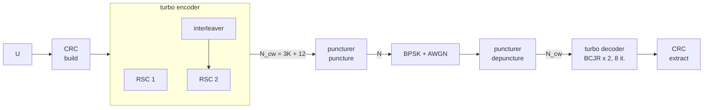

# Turbo codes

Script: `examples/turbo_lte.py`. This page reproduces the AFF3CT reference
`refs/TURBO/AWGN/BPSK/RSC_RSC/BCJR/LTE/Turbo_N4096_K2048_BCJR_i8_ref_LTE.txt`: the LTE turbo code, $K = 2048$,
a 24-bit CRC, punctured to rate 1/2, 8 iterations of a max-log-MAP BCJR decoder.



## From keywords

```python
--8<-- "examples/turbo_lte.py:keywords"
```

## From the AFF3CT command line

```python
--8<-- "examples/turbo_lte.py:command_line"
```

with

```python
--8<-- "examples/turbo_lte.py:command"
```

## The chain

```python
--8<-- "examples/turbo_lte.py:chain"
```

The decoder stops its iterations when the CRC is verified, which saves most of them at high SNR.


## Other turbo codes

- `af.codec.turbo_db`: double-binary turbo codes (DVB-RCS1, DVB-RCS2), `enc_sub_standard="DVB-RCS1"`;
- `af.codec.turbo_product`: product of two BCH codes, Chase-Pyndiah decoder;
- the interleaver is chosen with `itl_core_type` (`LTE`, `CCSDS`, `DVB-RCS1`, `RANDOM`, `ROW_COL`...).
