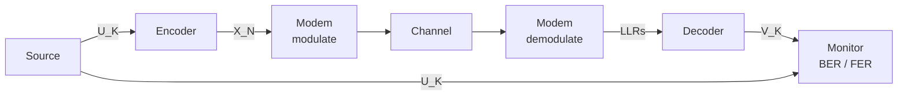

# pyAFF3CT

**pyAFF3CT** is the Python interface of [AFF3CT](https://aff3ct.github.io), *A Fast Forward Error Correction
Toolbox*. It exposes the modules of AFF3CT (sources, encoders, decoders, modems, channels, monitors...) and its
tools (frozen bits generators, LDPC matrices, noise...) to Python, on top of
[pyStreamPU](https://github.com/aff3ct/pystreampu):

- every AFF3CT module is a `streampu.Module`: its tasks are Python methods, its sockets are NumPy arrays;
- calling a task executes it **and binds it** to the tasks that produced its inputs, so a chain written as plain
  Python calls is also a graph that a `streampu.Sequence` executes in C++, on several threads;
- the codes are available as *codecs* (`aff3ct.codec.polar(...)`, `aff3ct.codec.turbo(...)`...) with the
  parameters of the AFF3CT command line, and the AFF3CT command line itself can be used to configure them.



```python
--8<-- "examples/first_chain.py:modules"
```

The curves below are computed by the examples of this documentation each time it is built, and compared with the
reference curves of the AFF3CT simulator:


## Where to start

<div class="grid cards" markdown>

- **[Installation](install.md)**: build the package against pyStreamPU.
- **[Tutorial](tutorial/first_chain.md)**: a first chain, BER/FER curves, codecs, the command line.
- **[How-to guides](guides/polar.md)**: polar, LDPC and turbo codes, modulations, fixed point.
- **[Concepts](concepts.md)**: tasks and sockets, data types, bits, clones.
- **[API reference](reference/index.md)**: every module, codec, tool and factory.

</div>

!!! note "Tested documentation"
    Every code block of this documentation comes from a script of the `examples/` directory or is a doctest:
    the continuous integration runs them and checks their results (against theory or the AFF3CT references), so
    the documentation cannot drift from the code.
