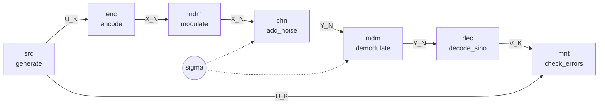

# A first chain

This page builds a complete digital communication chain: a polar code of 96 information bits and 128 coded bits,
a BPSK modulation and an additive white Gaussian noise (AWGN) channel.



The full script is `examples/first_chain.py`, in the repository.

## The modules

```python
--8<-- "examples/first_chain.py:modules"
```

Each `aff3ct.<family>.<name>(...)` function creates a module with an AFF3CT factory: the keyword parameters are
those of the factory (`type`, `implem`, `n_ite`...) and keep their AFF3CT default when they are not given.
`help(af.dec.polar)` lists them.

The polar code needs its *frozen bits*: the positions of the codeword that carry no information. They depend on the
noise, given as a `Sigma` object computed from the Eb/N0 ratio and the code rate.

## One frame

```python
--8<-- "examples/first_chain.py:frame"
```

A task is called as a method (`enc.encode(u)`): it is executed immediately and returns its output socket(s), which
are views on NumPy arrays (`u.numpy` has the shape `(n_frames, K)`). The value of the noise is given to the channel
and to the demodulator through a socket, `sigma`, created by `streampu.array`: changing its content changes the
noise of the next executions.

## Many frames: a Sequence

Each call has also **bound** the input sockets of a task to the output sockets it received. The chain is therefore a
graph, that a `streampu.Sequence` can execute in C++ without going back to Python:

```python
--8<-- "examples/first_chain.py:sequence"
```

The monitor stops the sequence when it has counted `max_fe` frames with errors; `mnt.fer` and `mnt.ber` are then
the frame and bit error rates at this Eb/N0.

Next: [simulating BER / FER curves](bfer.md), on several threads.
